# Nusa Stay Hotels — Sistem Pemesanan Hotel Multi-Cabang

[](https://github.com/romanussudimin-debu/Sistem-Pemesanan-Hotel/actions/workflows/tests.yml)


> 🇮🇩 Bahasa Indonesia · [🇬🇧 English](#-english)

Aplikasi web pemesanan kamar untuk **jaringan hotel fiktif dengan tiga cabang di Bali** (Jimbaran, Ubud, Seminyak). Proyek ini dikerjakan dari hulu ke hilir, mulai dari analisis kebutuhan (SRS), pemodelan proses (BPMN, UML), perancangan basis data, dan wireframe, sampai aplikasi Laravel yang teruji otomatis.

Masalah utama yang diselesaikan adalah **pemesanan ganda (overbooking)**. Sistem menjamin satu kamar tidak pernah terjual dua kali pada malam yang sama, bahkan ketika puluhan tamu memesan pada detik yang sama.

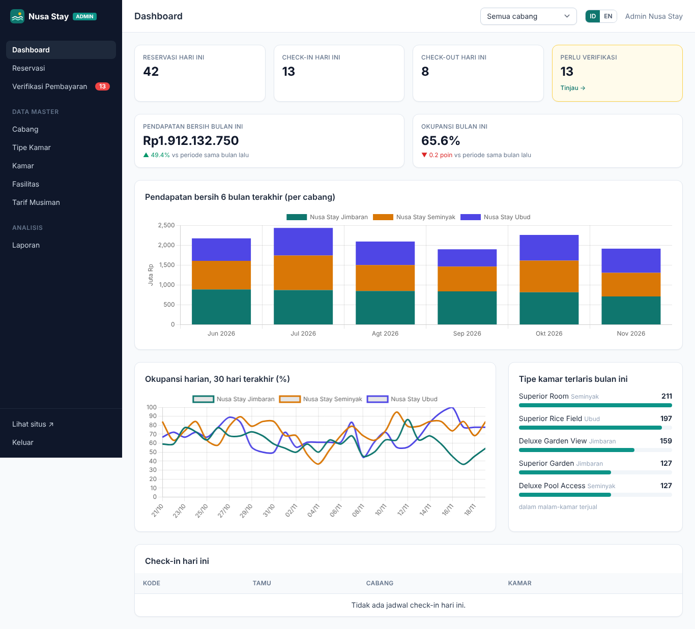

---

## ✨ Fitur

**Pelanggan**
- Cari kamar per cabang, tanggal, jumlah tamu, dan jumlah kamar, dengan ketersediaan real-time dan saran cabang lain bila kamar habis
- Detail kamar dengan rincian tarif per malam (tarif musiman otomatis) serta pajak & layanan 21%
- Checkout 4 langkah dengan validasi kapasitas dan lama menginap
- Pembayaran dengan dua metode:
  - **simulasi payment gateway** (MockPay, callback bertanda tangan HMAC);
  - **transfer bank dengan unggah bukti**, disertai hitung mundur batas bayar.
- Riwayat pesanan, pembatalan dengan estimasi refund sesuai kebijakan, dan voucher siap cetak/PDF
- Antarmuka & email **dwibahasa (Indonesia/Inggris)** dengan tombol pengalih bahasa

**Admin**
- Dashboard: reservasi, check-in, dan check-out hari ini; antrean verifikasi; pendapatan dan okupansi bulan ini; grafik Chart.js
- Verifikasi bukti transfer dengan daftar periksa. Penolakan ke-3 otomatis membatalkan reservasi
- Kelola cabang, tipe kamar (foto & fasilitas), kamar fisik, fasilitas, dan tarif musiman
- Kelola reservasi: filter, check-in/check-out, pembatalan (termasuk no-show), dan jejak audit status
- Laporan okupansi, pendapatan (kotor/refund/bersih), jumlah reservasi, dan kamar terlaris, per cabang maupun gabungan, dengan ekspor CSV/Excel dan PDF

**Otomatis**
- Reservasi yang tidak dibayar menjadi **kedaluwarsa** setiap 5 menit, dan kamarnya dilepas
- Email notifikasi untuk setiap perubahan status (dikirim setelah transaksi commit)

## 🛡️ Sorotan teknis: anti-overbooking tiga lapis

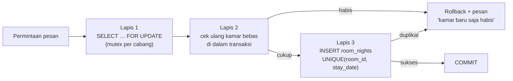

Hasil uji konkurensi sungguhan (`php artisan hotel:concurrency-test`, MySQL/MariaDB, proses paralel):

| Skenario | Berhasil | Ditolak | Malam ganda |
|---|---|---|---|
| 12 proses berebut 3 kamar | 3 | 9 | **0** |
| 20 proses berebut 4 kamar | 4 | 16 | **0** |
| Kontrol: lapis 1 dimatikan | 2 | 18 | **0**, tetapi 1 kamar gagal terjual |

Baris kontrol menunjukkan peran tiap lapis. Indeks unik (lapis 3) sudah cukup mencegah overbooking, sedangkan kunci (lapis 1) mencegah penolakan palsu yang membuat hotel kehilangan penjualan. Uji ini juga dijalankan GitHub Actions pada setiap push.

Keputusan desain lain:
- **State machine** status reservasi di `ReservationStatus`, dengan satu pintu perubahan status (`Reservation::transitionTo()`) yang otomatis menulis log audit
- **Snapshot tarif** (JSON) pada setiap reservasi, sehingga perubahan harga tidak mengubah tagihan lama
- **Service layer** (`ReservationService`, `PaymentService`, `ReportService`, …) dengan controller tipis, Form Request, dan Policy
- Semua aturan bisnis bisa dikonfigurasi di [`config/hotel.php`](config/hotel.php)

## 🧰 Teknologi

| Lapisan | Teknologi |
|---|---|
| Backend | PHP 8.3, Laravel 13, Laravel Breeze (autentikasi + verifikasi email) |
| Basis data | MySQL 8 / MariaDB 10.6+ (SQLite untuk test) |
| Frontend | Blade, Tailwind CSS 3, Alpine.js, Chart.js 4, Vite |
| Kualitas | PHPUnit (76 test, 337 assertion), Laravel Pint (PSR-12), GitHub Actions |

## 📸 Tangkapan layar

| | |
|---|---|
| 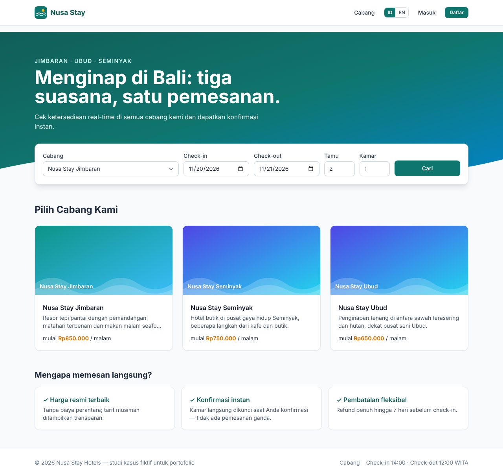 **Beranda** | 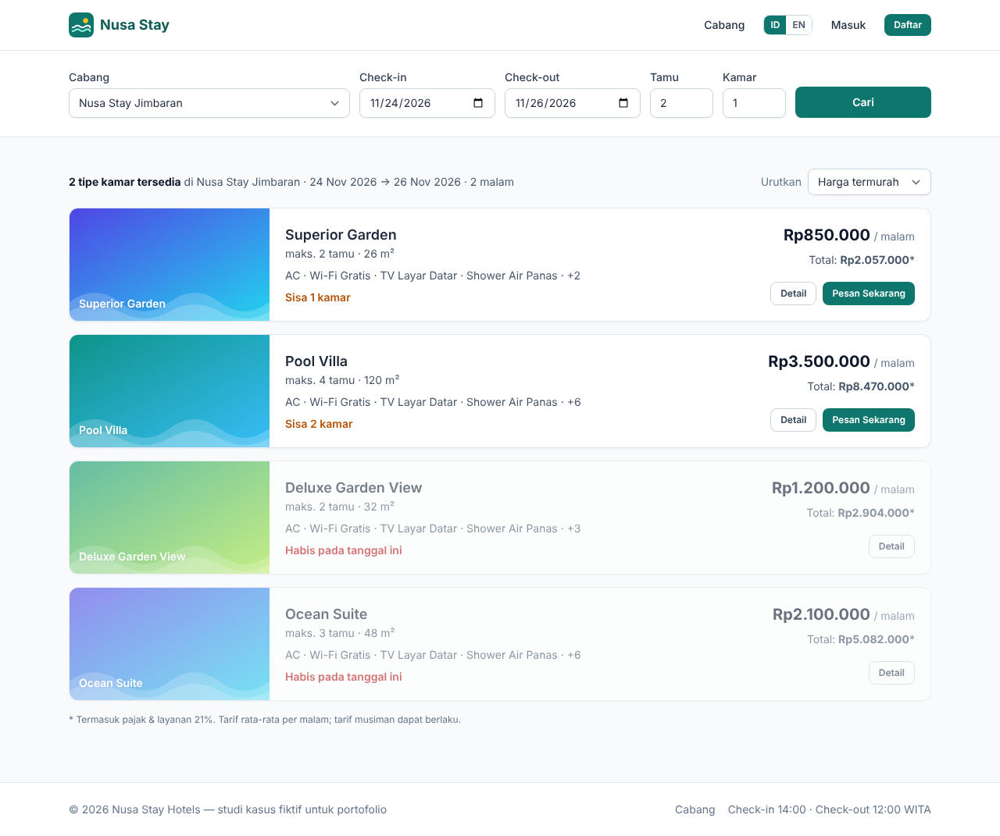 **Hasil pencarian** |
|  **Detail kamar & rincian tarif** | 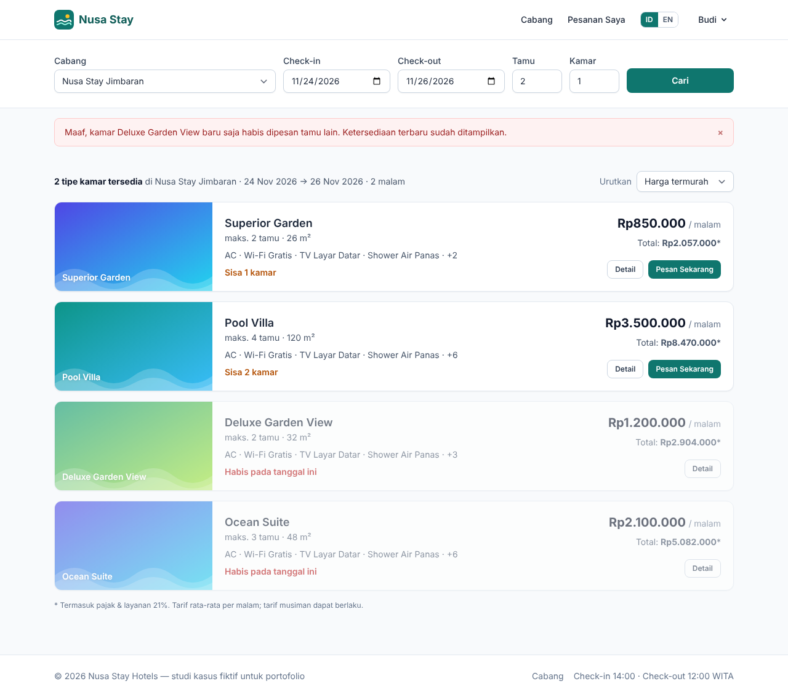 **Checkout** |
| 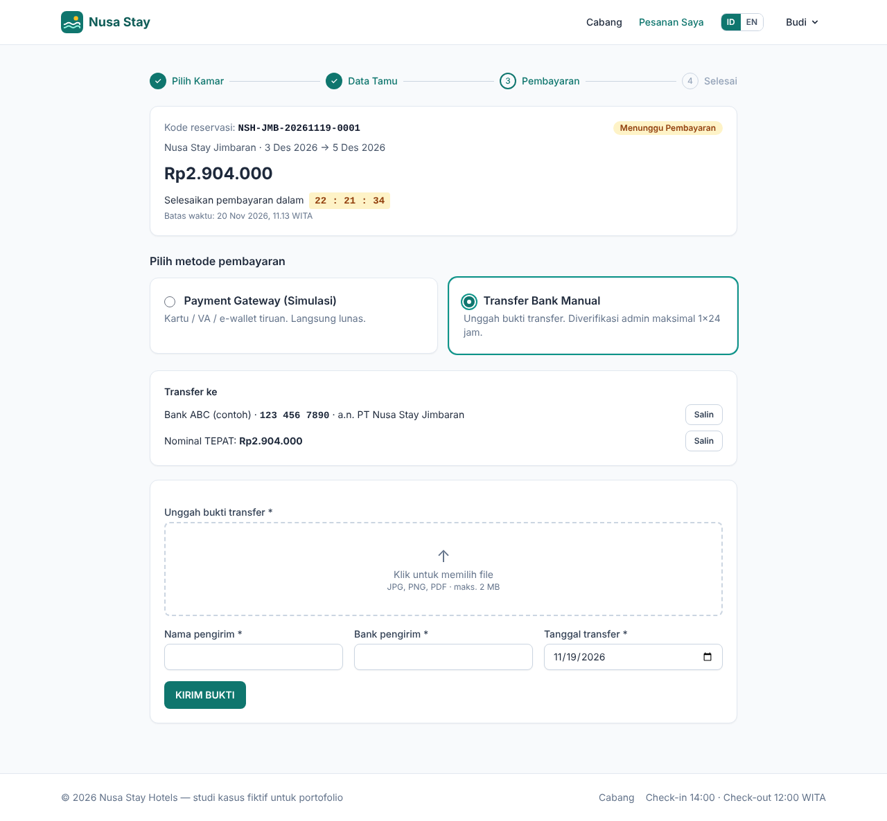 **Pembayaran & unggah bukti** | 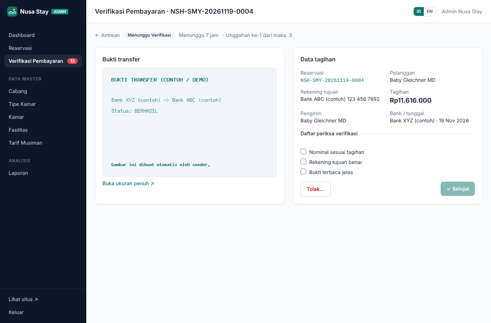 **Verifikasi pembayaran (admin)** |
| 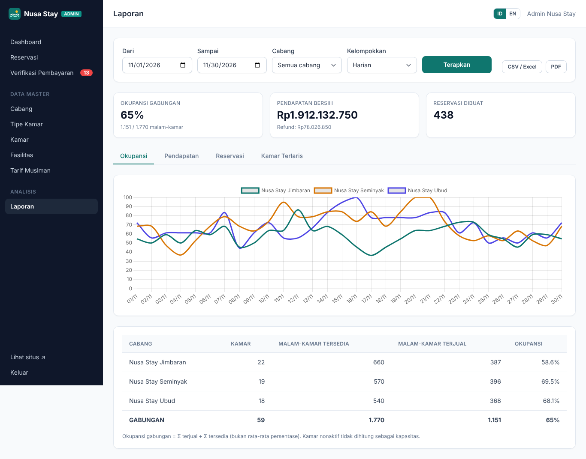 **Laporan okupansi** | 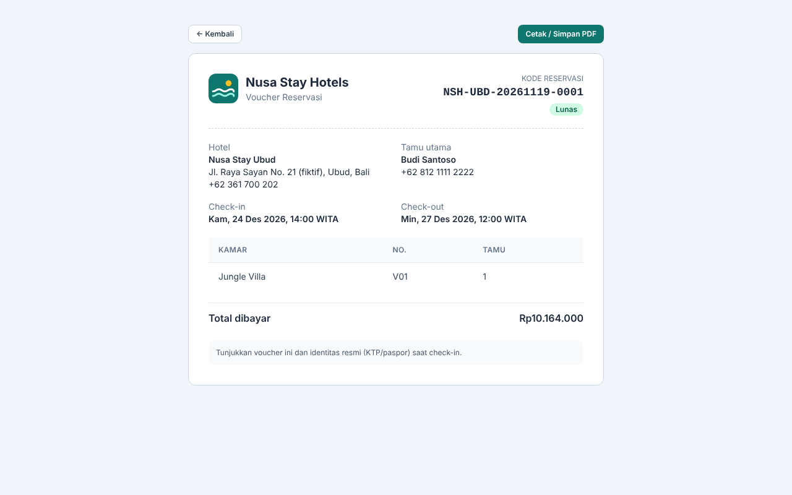 **Voucher** |
| 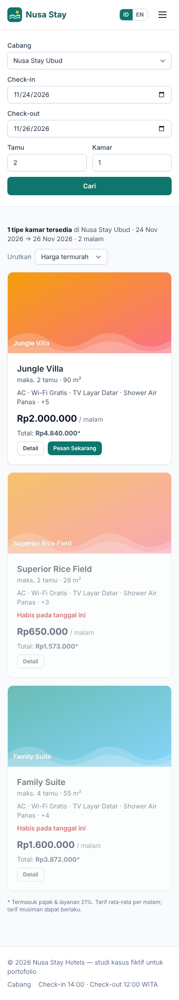 **Tampilan mobile** | 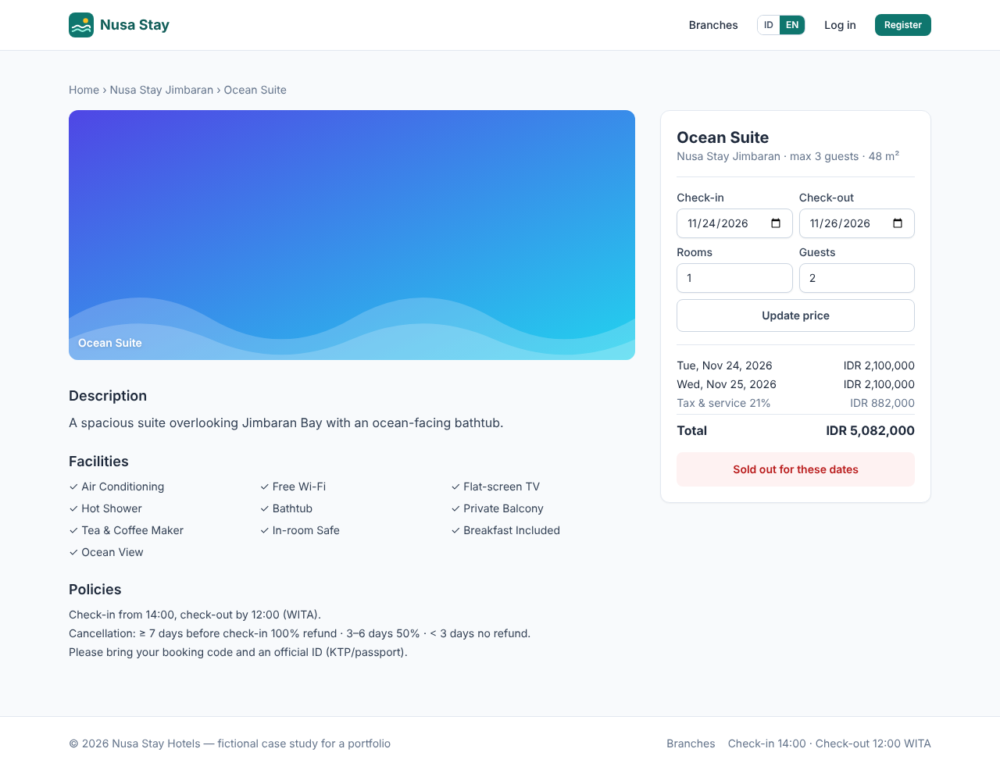 **Mode Bahasa Inggris** |

## 🚀 Menjalankan secara lokal

```bash
git clone https://github.com/romanussudimin-debu/Sistem-Pemesanan-Hotel.git
cd Sistem-Pemesanan-Hotel
composer install && npm install && npm run build
cp .env.example .env && php artisan key:generate
# buat database MySQL "nusa_stay" lalu sesuaikan DB_* di .env
php artisan migrate --seed && php artisan storage:link
php artisan serve
```

Buka `http://localhost:8000`. Untuk kedaluwarsa otomatis dan email, jalankan juga `php artisan schedule:work` dan `php artisan queue:work`. Panduan lengkap beserta deployment ke VPS ada di **[docs/INSTALL.md](docs/INSTALL.md)**.

### Akun demo (kata sandi: `password`)

| Peran | Email | Keterangan |
|---|---|---|
| Admin | `admin@nusastay.test` | Seluruh panel admin |
| Pelanggan | `budi@contoh.test` | Satu reservasi untuk setiap status (menunggu bayar, menunggu verifikasi, lunas, selesai) |
| Pelanggan | `john@example.test` | Antarmuka & email berbahasa Inggris |

Seeder membuat 3 cabang, 10 tipe kamar, 60 kamar, tarif musiman, dan sekitar 3.200 reservasi histori (6 bulan ke belakang sampai 60 hari ke depan) yang konsisten, sehingga dashboard dan laporan langsung berisi data.

## 🧪 Pengujian

```bash
php artisan test                                  # 76 test
php artisan hotel:concurrency-test --workers=20   # butuh MySQL/MariaDB + ekstensi pcntl
```

Cakupan test:
- seluruh kasus uji ketersediaan (TC-AV-01 s.d. 08);
- alur pembayaran gateway dan transfer, termasuk signature palsu, callback ganda, dan callback terlambat;
- penolakan bukti 3 kali dan perpanjangan batas bayar;
- kebijakan refund;
- hak akses antarpengguna dan admin;
- laporan;
- smoke test semua halaman dalam dua bahasa.

## 📁 Struktur proyek (ringkas)

```
app/
├── Enums/            # ReservationStatus (state machine), PaymentStatus, RoomStatus, …
├── Services/         # ReservationService, AvailabilityService, PricingService,
│                     # PaymentService, PaymentVerificationService, CancellationPolicy, ReportService
├── Http/Controllers/ # publik, pelanggan, Admin/*
├── Http/Requests/    # Form Request (validasi aturan bisnis)
├── Policies/         # ReservationPolicy (kepemilikan data)
└── Console/Commands/ # reservations:expire, hotel:concurrency-test
config/hotel.php      # semua aturan bisnis (pajak, batas bayar, refund, …)
database/             # 8 migration domain, seeder data demo
lang/                 # id.json, id/*, en/* (dwibahasa)
resources/views/      # Blade + Tailwind (publik, admin)
tests/                # Feature & Unit
docs/                 # INSTALL.md, CASE_STUDY.md, screenshots/
```

## 📚 Dokumentasi

- **[Studi kasus portofolio](docs/CASE_STUDY.md)**: masalah, peran, proses analisis, solusi, hasil, dan pelajaran
- **[Panduan instalasi & deployment](docs/INSTALL.md)**

## ⚠️ Batasan

- Data, nama hotel, dan rekening bank sepenuhnya **fiktif**.
- Payment gateway hanya **simulasi**. Integrasi nyata (Midtrans/Xendit) cukup mengganti `PaymentService` karena kontrak callback-nya sudah meniru gateway sungguhan.
- Refund dicatat sistem, tetapi pengembaliannya diproses manual.
- Belum ada foto asli. Kartu kamar memakai placeholder gradasi, dan foto bisa diunggah dari panel admin.

## 👤 Penulis

**Romanus Sudimin**, mahasiswa Sistem Informasi, Institut Teknologi dan Bisnis STIKOM Bali.
Peran: analisis sistem (SRS, BPMN, UML, ERD, wireframe) dan pengembangan aplikasi.

---

## 🇬🇧 English

**Nusa Stay Hotels** is a booking web app for a **fictional three-branch hotel chain in Bali** (Jimbaran, Ubud, Seminyak). It was built end to end, from requirements analysis (SRS), process modelling (BPMN, UML), database design, and wireframes, to a fully tested Laravel application.

The core problem it solves is **overbooking**: a room can never be sold twice for the same night, even when dozens of guests book in the same second.

### Features

- **Customers:**
  - real-time search per branch and dates, with alternative-branch suggestions;
  - per-night pricing with seasonal rates and 21% tax;
  - 4-step checkout;
  - payment via a **simulated gateway** (HMAC-signed callbacks) or **bank-transfer receipt upload** with a deadline countdown;
  - booking history, policy-based cancellation with refund estimate, and a printable voucher;
  - **bilingual UI and emails (ID/EN)**.
- **Admins:**
  - dashboard with KPIs and Chart.js charts;
  - receipt verification with a checklist (3rd rejection auto-cancels);
  - CRUD for branches, room types, rooms, facilities, and seasonal rates;
  - booking management with check-in/out and audit trail;
  - occupancy, revenue, booking-count, and best-seller reports with CSV and PDF export.
- **Automated:** unpaid bookings expire every 5 minutes and release their rooms. Email notifications are sent after commit.

### Technical highlight: three-layer overbooking protection

1. **Mutex:** `SELECT … FOR UPDATE` on the branch row as the first statement of the transaction.
2. **Re-check** of free rooms inside the transaction.
3. **`UNIQUE(room_id, stay_date)`** on the `room_nights` ledger as the final safety net.

A real multi-process concurrency test (`php artisan hotel:concurrency-test`) produced:
- 20 processes competing for 4 rooms: exactly 4 succeed, 0 duplicate nights;
- control run with layer 1 disabled: still 0 duplicate nights, but one room went unsold.

This shows why both the lock and the unique index matter. The test runs in GitHub Actions on every push.

Other design choices: a booking-status state machine with a single `transitionTo()` entry point and automatic audit log, JSON rate snapshots, a service layer with thin controllers, Form Requests and Policies, and all business rules configurable in `config/hotel.php`.

### Tech stack

PHP 8.3 · Laravel 13 · Breeze · MySQL 8 / MariaDB · Blade · Tailwind CSS · Alpine.js · Chart.js · Vite · PHPUnit (76 tests) · Pint · GitHub Actions.

### Run locally

See the commands above or **[docs/INSTALL.md](docs/INSTALL.md)**. Demo accounts (password `password`): `admin@nusastay.test`, `budi@contoh.test`, and `john@example.test` (English UI).

### Documentation

- **[Portfolio case study](docs/CASE_STUDY.md)** (Indonesian and English)
- **[Installation & deployment guide](docs/INSTALL.md)**

### Limitations

All data is fictional, the payment gateway is simulated, refunds are recorded but processed manually, and room photos are placeholders until uploaded.

**Author:** Romanus Sudimin, Information Systems student, ITB STIKOM Bali (systems analysis and development).
