# 02 · Pemodelan Proses & Sistem

**Sistem Pemesanan Hotel Multi-Cabang — "Nusa Stay Hotels" (fiktif)**

> 🇮🇩 Bahasa Indonesia · [🇬🇧 English](#-english-version) · ← [01 · SRS](01-srs.md) · → [03 · Basis Data](03-basis-data.md)
>
> Status: **as-built**. Diagram BPMN, use case, dan activity ditulis dengan Mermaid `flowchart` karena Mermaid belum mendukung notasi tersebut secara native. Untuk use case juga tersedia versi PlantUML (notasi UML standar).

| Notasi BPMN/UML | Representasi di Mermaid |
|---|---|
| Event mulai/selesai | Lingkaran `(( ))` atau stadion `([ ])` |
| Task / aktivitas | Persegi `[ ]` |
| Gateway / keputusan | Belah ketupat `{ }` |
| Lane (swimlane) | `subgraph` |
| «include» / «extend» | Panah putus-putus berlabel |

---

## 2.1 BPMN Proses Pemesanan

Elemen yang dipakai mengacu pada BPMN 2.0.2 (Object Management Group [OMG], 2013).

### 2.1.1 As-Is: Pemesanan Manual (Telepon/WhatsApp)

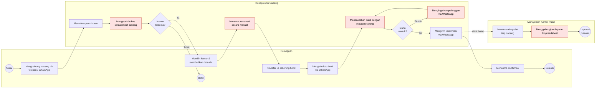

| Aktivitas (merah) | Masalah | Keterangan |
|---|---|---|
| Mengecek buku/spreadsheet | P1, P4 | Data tidak real-time; dua resepsionis bisa menjual kamar yang sama |
| Mencatat reservasi manual | P1 | Tidak ada penguncian kamar |
| Mencocokkan bukti transfer | P2 | Bukti tercecer di chat |
| Mengingatkan pelanggan | P3 | Tidak ada batas waktu jelas |
| Menggabungkan laporan | P5 | Rekap manual, terlambat |

### 2.1.2 To-Be: Pemesanan Online

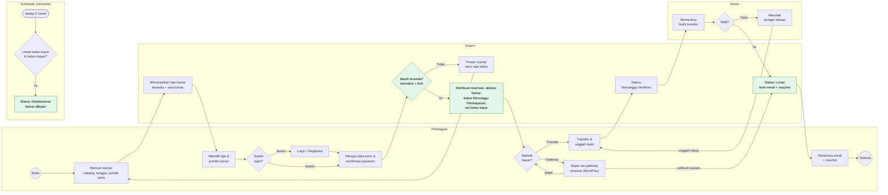

| Aspek | As-Is | To-Be | Masalah terselesaikan |
|---|---|---|---|
| Cek ketersediaan | Manual per cabang | Otomatis, terpusat, real-time | P1, P4 |
| Pencegahan pemesanan ganda | Tidak ada | Transaksi DB + row lock + indeks unik | P1 |
| Batas waktu bayar | Tidak jelas | 24 jam / 2 jam, kedaluwarsa otomatis | P3 |
| Verifikasi pembayaran | Chat WhatsApp | Antrean verifikasi + bukti tersimpan | P2 |
| Jam layanan | Jam kerja staf | 24/7 self-service | P4 |
| Laporan | Rekap bulanan manual | Dashboard real-time | P5 |

---

## 2.2 Use Case

| ID | Use Case | Aktor | Relasi | FR |
|---|---|---|---|---|
| UC-01 | Registrasi & Verifikasi Email | Pelanggan | — | FR-01 |
| UC-02 | Login / Logout / Reset Sandi | Pelanggan, Admin | — | FR-02, FR-03 |
| UC-03 | Mengganti Bahasa | Pelanggan, Admin | — | FR-05 |
| UC-04 | Mengelola Profil | Pelanggan | — | FR-04 |
| UC-05 | Mencari Kamar | Pelanggan | «include» UC-08 | FR-06 |
| UC-06 | Melihat Detail Tipe Kamar | Pelanggan | «extend» UC-05 | FR-07 |
| UC-07 | Memesan Kamar | Pelanggan | «include» UC-08, UC-24 | FR-08–FR-11 |
| UC-08 | Memeriksa Ketersediaan | (internal) | diinclude | FR-10 |
| UC-09 | Membayar Reservasi | Pelanggan | diextend UC-10, UC-11 | FR-12 |
| UC-10 | Bayar via Gateway Simulasi | Pelanggan, Gateway | «extend» UC-09 | FR-13 |
| UC-11 | Mengunggah Bukti Transfer | Pelanggan | «extend» UC-09 | FR-14 |
| UC-12 | Melihat Riwayat Reservasi | Pelanggan | — | FR-19 |
| UC-13 | Membatalkan Reservasi | Pelanggan, Admin | «include» UC-24 | FR-20, FR-21 |
| UC-14 | Mengunduh Voucher | Pelanggan | «extend» UC-12 | FR-18 |
| UC-15 | Memverifikasi Pembayaran | Admin | «include» UC-24 | FR-15 |
| UC-16 | Mengelola Cabang | Admin | — | FR-22, FR-27 |
| UC-17 | Mengelola Tipe Kamar & Fasilitas | Admin | — | FR-23, FR-25, FR-27 |
| UC-18 | Mengelola Kamar | Admin | — | FR-24, FR-27 |
| UC-19 | Mengelola Tarif Musiman | Admin | — | FR-26 |
| UC-20 | Mengelola Reservasi & Check-in/out | Admin | — | FR-28, FR-29 |
| UC-21 | Melihat Dashboard | Admin | — | FR-30 |
| UC-22 | Melihat & Mengekspor Laporan | Admin | — | FR-31–FR-35 |
| UC-23 | Mengedaluwarsakan Reservasi | Scheduler | «include» UC-24 | FR-16 |
| UC-24 | Mengirim Notifikasi Email | (internal) | diinclude | FR-17 |

### 2.2.1 Diagram (Mermaid)

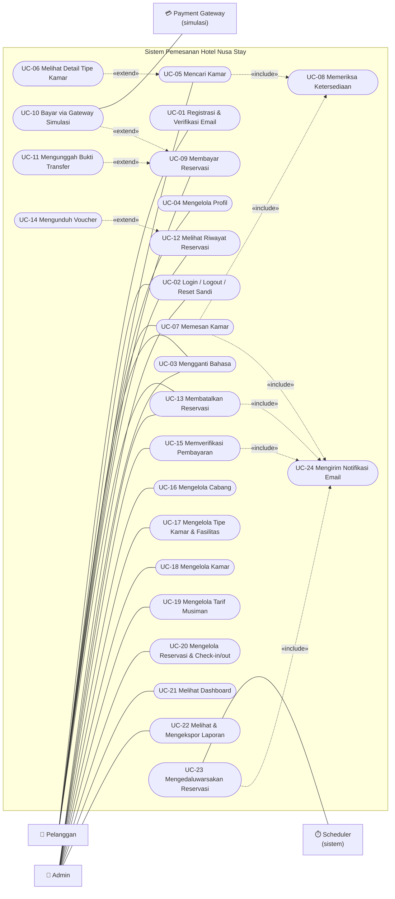

### 2.2.2 Diagram (PlantUML)

GitHub tidak merender PlantUML secara native. Render lewat [plantuml.com](https://www.plantuml.com/plantuml) atau ekstensi editor.

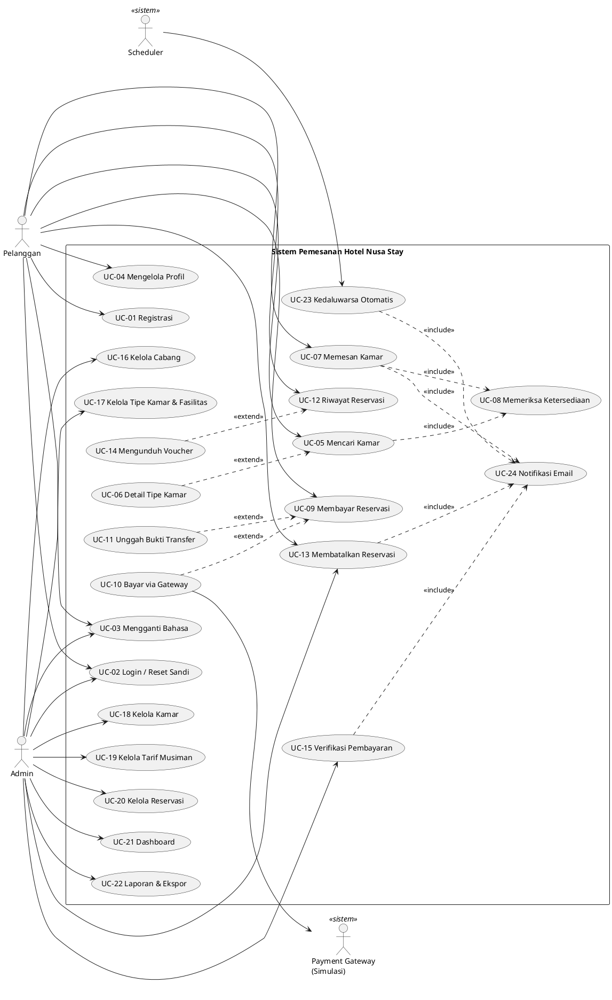

---

## 2.3 Skenario Use Case Utama

Format *fully dressed use case* (Cockburn, 2001).

### UC-05 · Mencari Kamar

| Elemen | Isi |
|---|---|
| Aktor | Pelanggan (termasuk tamu yang belum login) |
| Prakondisi | Ada cabang aktif dengan tipe kamar aktif |
| Pascakondisi | Daftar tipe kamar ditampilkan; tidak ada data berubah |
| FR / BR | FR-06, FR-07 · BR-01, BR-02, BR-04–BR-06 |

| # | Aktor | Sistem |
|---|---|---|
| 1 | Mengisi cabang, check-in, check-out, tamu, kamar; menekan "Cari" | — |
| 2 | — | Memvalidasi input (BR-01, BR-02) |
| 3 | — | Menghitung kamar tersedia per tipe = kamar aktif − kamar dengan malam beririsan (UC-08) |
| 4 | — | Menandai tipe yang memenuhi kapasitas & jumlah kamar; tipe lain tampil redup |
| 5 | — | Menampilkan foto, kapasitas, fasilitas, tarif per malam, estimasi total, label "sisa n kamar" |
| 6 | Membuka detail (UC-06) atau memesan (UC-07) | — |

| Kode | Kondisi | Alur alternatif |
|---|---|---|
| A1 | Input tidak valid | Pesan galat per field dalam bahasa aktif |
| A2 | Tidak ada tipe tersedia | Pesan + saran cabang lain yang tersedia pada tanggal sama |
| A3 | Mengubah urutan | Hasil diurutkan ulang tanpa menghitung ulang ketersediaan |

### UC-07 · Memesan Kamar

| Elemen | Isi |
|---|---|
| Aktor | Pelanggan |
| Prakondisi | Sudah mencari (UC-05); login dengan email terverifikasi |
| Pascakondisi sukses | Reservasi tersimpan, kamar teralokasi, status **Menunggu Pembayaran**, batas bayar ditetapkan, email terkirim |
| Pascakondisi gagal | Tidak ada data tersimpan (rollback) |
| FR / BR | FR-08–FR-11, FR-17 · BR-01–BR-09 |

| # | Aktor | Sistem |
|---|---|---|
| 1 | Menekan "Pesan Sekarang" | — |
| 2 | — | Menampilkan checkout: rincian tarif per malam, pajak, total |
| 3 | Mengisi data tamu, tamu per kamar, permintaan khusus; menyetujui kebijakan; menekan "Konfirmasi" | — |
| 4 | — | Memvalidasi via Form Request (BR-01–BR-04) |
| 5 | — | Membuka transaksi; **mengunci baris cabang** (`FOR UPDATE`); memeriksa ulang kamar bebas |
| 6 | — | Menyimpan reservasi, item kamar (snapshot tarif), dan `room_nights`; mencatat log; commit |
| 7 | — | Mengirim email (antrean, setelah commit); mengarahkan ke halaman pembayaran |

| Kode | Kondisi | Alur alternatif |
|---|---|---|
| A1 | Belum login | Diarahkan ke login lalu kembali ke checkout |
| A2 | Validasi gagal | Pesan per field; isian tidak hilang |
| A3 | Kamar habis diambil pengguna lain | Rollback; kembali ke hasil pencarian dengan pesan "kamar baru saja habis" |
| E1 | Indeks unik `room_nights` menolak | Ditangani sama dengan A3 |

### UC-09 · Membayar Reservasi (UC-10, UC-11)

| Elemen | Isi |
|---|---|
| Prakondisi | Reservasi milik pelanggan, **Menunggu Pembayaran**, batas bayar belum lewat |
| Pascakondisi | Gateway sukses: **Lunas**. Transfer: **Menunggu Verifikasi** |
| FR / BR | FR-12–FR-14, FR-17, FR-18 · BR-09–BR-12 |

| # | Aktor | Sistem |
|---|---|---|
| 1 | Membuka halaman pembayaran | Menampilkan total, hitung mundur, metode |
| 2 | Memilih gateway, menekan "Bayar" | Membuat `payment` (pending, `gateway_ref` unik); mengarahkan ke MockPay |
| 3 | Memilih "Simulasikan BERHASIL" | — |
| 4 | Gateway mengirim callback (ref, nominal, hasil, signature HMAC) | Memverifikasi signature & nominal; payment approved; reservasi **Lunas**; email + voucher |

| Kode | Kondisi | Alur alternatif |
|---|---|---|
| A1 | Memilih transfer (UC-11) | Menampilkan rekening cabang & nominal; pelanggan mengunggah bukti; disimpan privat; status **Menunggu Verifikasi**; admin diberi notifikasi |
| A2 | Simulasi gagal | Payment failed; tetap Menunggu Pembayaran |
| A3 | Batas bayar lewat | Pembayaran tidak dapat dilakukan |
| A4 | Bukti sebelumnya ditolak | Alasan & sisa kesempatan ditampilkan |
| E1 | Signature/nominal salah | HTTP 400, status tidak berubah |
| E2 | Callback sukses tiba setelah kedaluwarsa | Sistem mencoba alokasi ulang kamar yang sama; bila gagal, refund 100% ditandai |

### UC-13 · Membatalkan Reservasi

| Elemen | Isi |
|---|---|
| Prakondisi | Status Menunggu Pembayaran / Menunggu Verifikasi / Lunas (BR-15); pelanggan pemilik atau admin |
| Pascakondisi | Status **Dibatalkan**, refund tercatat, `room_nights` dihapus, email terkirim |

| # | Aktor | Sistem |
|---|---|---|
| 1 | Menekan "Batalkan reservasi" | Memeriksa Policy & status |
| 2 | — | Menampilkan estimasi refund (BR-13/BR-14) |
| 3 | Mengonfirmasi (alasan wajib untuk admin) | Dalam satu transaksi: simpan refund, batalkan pembayaran menggantung, lepas kamar, ubah status + log |

| Kode | Kondisi | Alur alternatif |
|---|---|---|
| A1 | Status tidak dapat dibatalkan | Tombol tidak tampil; akses paksa → 403 |
| A2 | Admin (no-show) | Alasan wajib; refund mengikuti kebijakan |

### UC-15 · Memverifikasi Pembayaran

| Elemen | Isi |
|---|---|
| Prakondisi | Admin login; ada pembayaran `submitted` |
| Pascakondisi | Disetujui: **Lunas**. Ditolak: **Menunggu Pembayaran**, atau **Dibatalkan** pada penolakan ke-3 |

| # | Aktor | Sistem |
|---|---|---|
| 1 | Membuka antrean verifikasi | Daftar terlama di atas; penanda merah bila > 24 jam |
| 2 | Memilih pembayaran | Menampilkan bukti (rute terotorisasi), tagihan, data pengirim, daftar periksa |
| 3 | Mencentang daftar periksa, menekan "Setujui" | Mengunci reservasi & pembayaran; approved; reservasi **Lunas**; email voucher |

| Kode | Kondisi | Alur alternatif |
|---|---|---|
| A1 | Bukti tidak valid | Alasan wajib; status kembali **Menunggu Pembayaran**; batas bayar diperpanjang 2 jam bila sudah lewat (BR-20) |
| A2 | Penolakan ke-3 | Reservasi **Dibatalkan** (BR-11) |
| A3 | Sudah diproses admin lain | Pesan "sudah diproses"; tidak ada perubahan ganda |

---

## 2.4 Activity Diagram

### AD-01 · Pencarian & Pemesanan

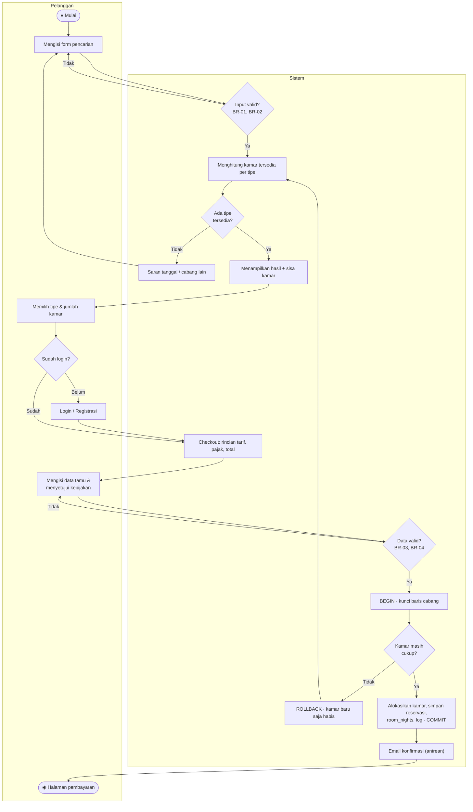

### AD-02 · Pembayaran

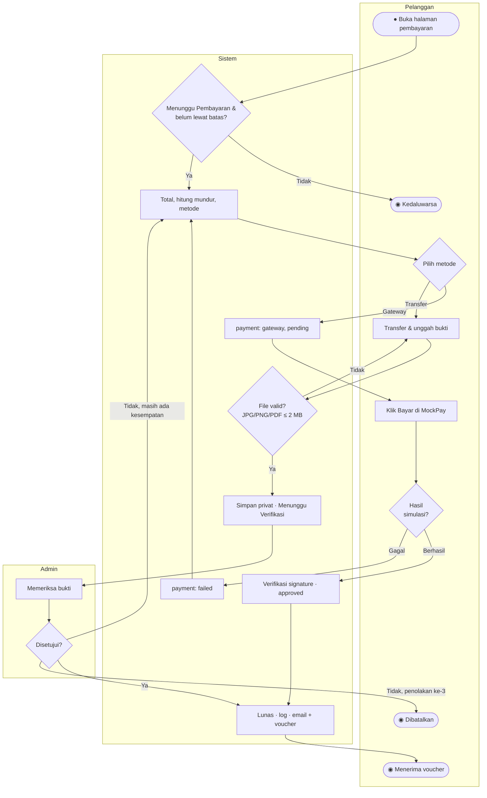

### AD-03 · Pembatalan

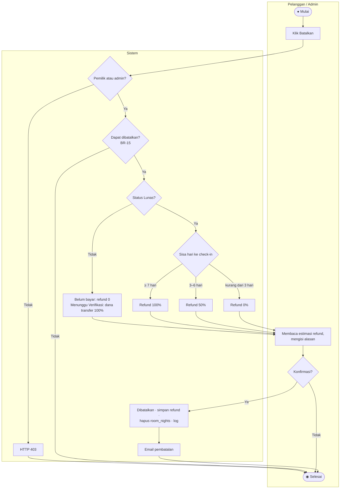

### State Diagram Status Reservasi (BR-18)

Diagram ini diimplementasikan di `App\Enums\ReservationStatus::allowedTransitions()`.

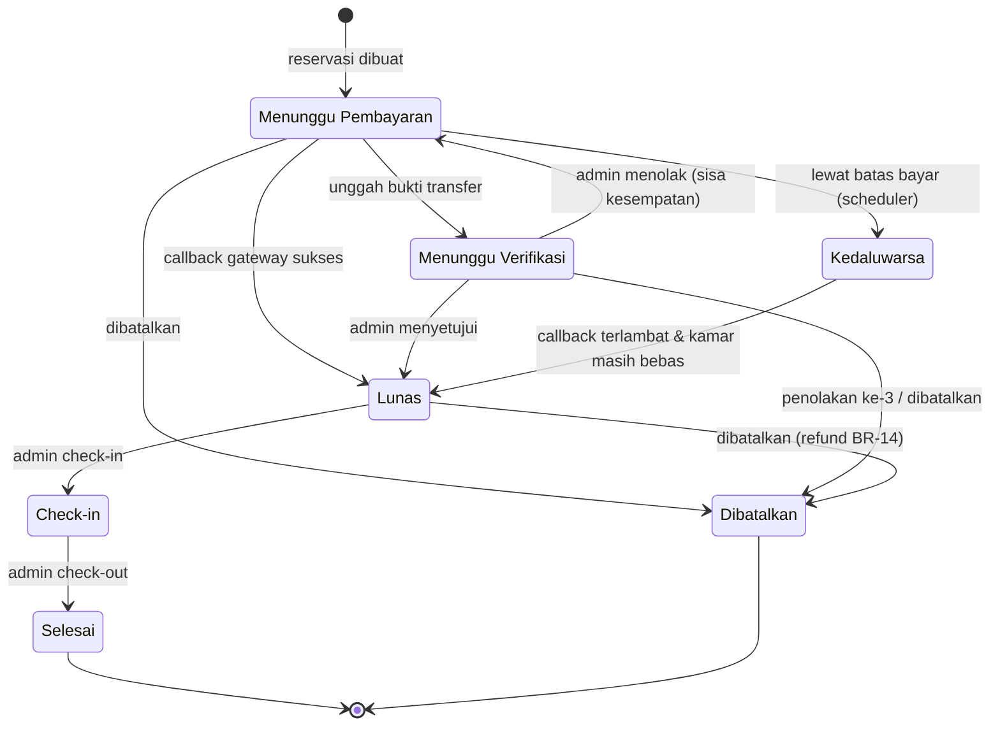

---

## 2.5 Sequence Diagram

### SD-01 · Pemesanan Kamar

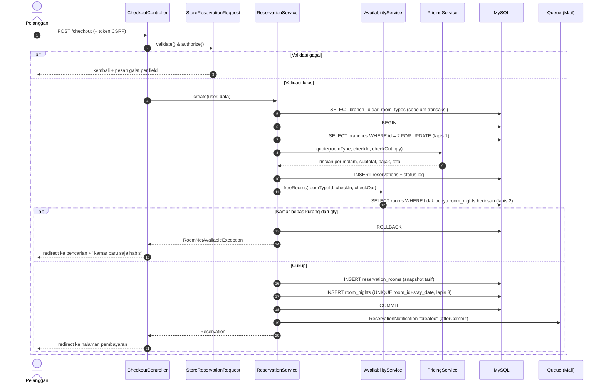

### SD-02 · Verifikasi Pembayaran (Transfer)

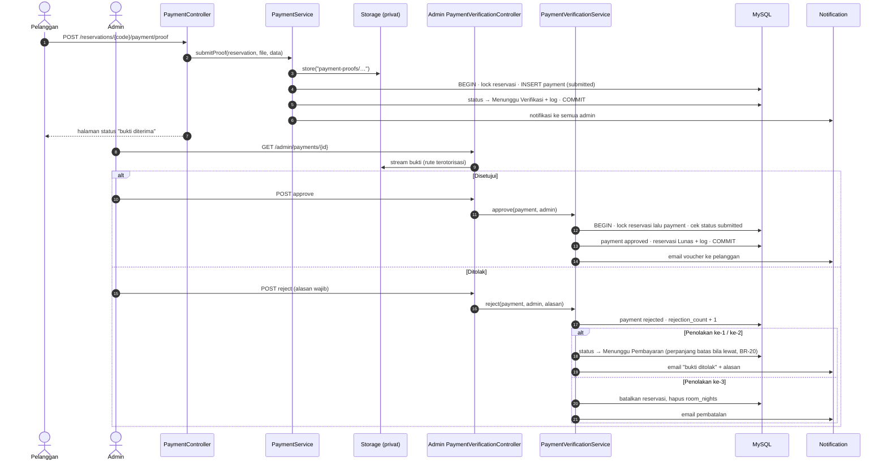

---

## 2.6 Class Diagram

Notasi UML 2.5.1 (OMG, 2017).

### 2.6.1 Model Domain

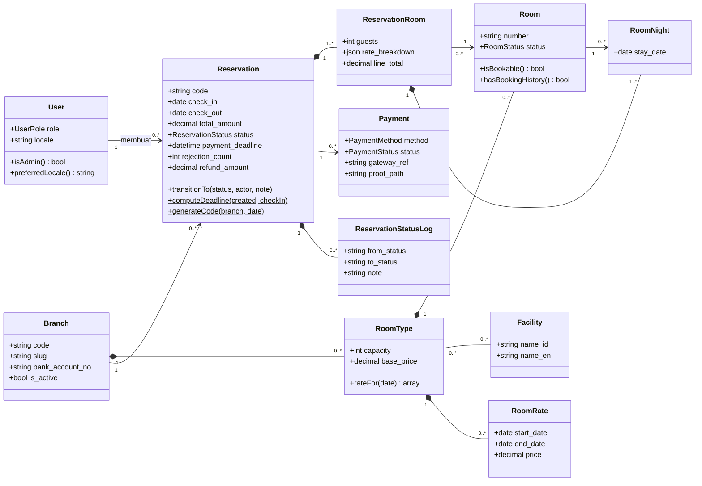

### 2.6.2 Lapisan Layanan

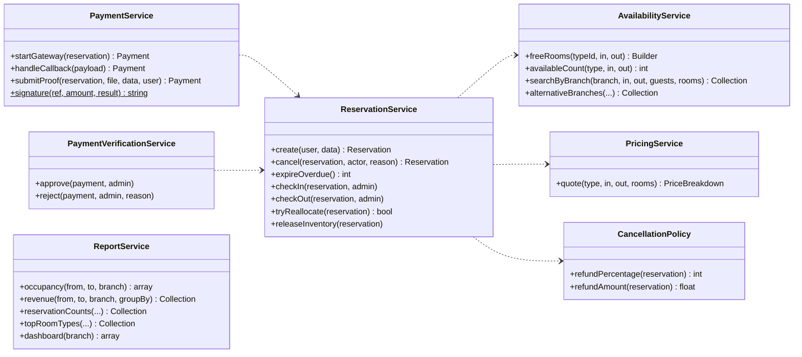

## Referensi

- Cockburn, A. (2001). *Writing effective use cases*. Addison-Wesley.
- Object Management Group. (2013). *Business Process Model and Notation (BPMN) version 2.0.2*. https://www.omg.org/spec/BPMN/2.0.2/
- Object Management Group. (2017). *OMG Unified Modeling Language (OMG UML) version 2.5.1*. https://www.omg.org/spec/UML/2.5.1/

---

## 🇬🇧 English Version

The diagrams above are shared by both versions. Code identifiers are in English, and the labels translate as in the glossary below.

| Indonesian | English | Indonesian | English |
|---|---|---|---|
| Pelanggan | Customer | Menunggu Pembayaran | Awaiting Payment |
| Resepsionis Cabang | Branch Receptionist | Menunggu Verifikasi | Awaiting Verification |
| Manajemen Kantor Pusat | Head Office | Lunas | Paid |
| Mulai / Selesai | Start / End | Selesai (status) | Completed |
| Mencari kamar | Search rooms | Dibatalkan | Cancelled |
| Memesan kamar | Book room | Kedaluwarsa | Expired |
| Membayar | Pay | Batas bayar | Payment deadline |
| Bukti transfer | Transfer receipt | Penolakan ke-3 | 3rd rejection |
| Kunci baris cabang | Lock branch row | Kamar baru saja habis | Room just sold out |

**BPMN.**
- **As-is:** a phone/WhatsApp process with five pain points: ledger checks, manual recording, receipt matching, chasing payments, and manual report consolidation.
- **To-be:** online search, locked transactional booking, gateway or transfer payment with an admin verification queue, and a scheduler that expires unpaid bookings every 5 minutes.

**Use cases.** 24 use cases with «include»/«extend» relations, traced to the FRs (table in 2.2).

**Key scenarios (summary):**
- **UC-05 Search:** validate dates → count free rooms per type → show results with "n left", dimming types that do not fit, and suggesting other branches when none are available.
- **UC-07 Book:** checkout → Form Request validation → transaction locking the branch row → re-check free rooms → save booking, rate snapshot, and `room_nights` → commit → queue email → redirect to payment. If rooms are gone (or the unique index fires), roll back and return to search.
- **UC-09 Pay:**
  - gateway: MockPay sends a callback with an HMAC signature, verified for signature and amount → Paid;
  - transfer: receipt stored privately → Awaiting Verification;
  - a late success callback after expiry triggers re-allocation, or a full refund flag.
- **UC-13 Cancel:** policy and status check → refund estimate → confirm (reason required for admins) → one transaction that records the refund, cancels hanging payments, releases rooms, and logs the change.
- **UC-15 Verify:** oldest-first queue → checklist → approve (Paid), or reject with a reason (back to Awaiting Payment, with the deadline extended per BR-20). The 3rd rejection cancels, and double processing is prevented by row locks.

**Activity diagrams.** AD-01 search & booking, AD-02 payment, and AD-03 cancellation with refund tiers. The **state diagram** is implemented in `ReservationStatus::allowedTransitions()`.

**Sequence diagrams.** SD-01 shows the three-layer booking transaction. SD-02 shows receipt upload, then admin approval or rejection.

**Class diagrams.** The domain model has 12 Eloquent models, including the `RoomNight` inventory ledger. The service layer has 7 services and thin controllers.
