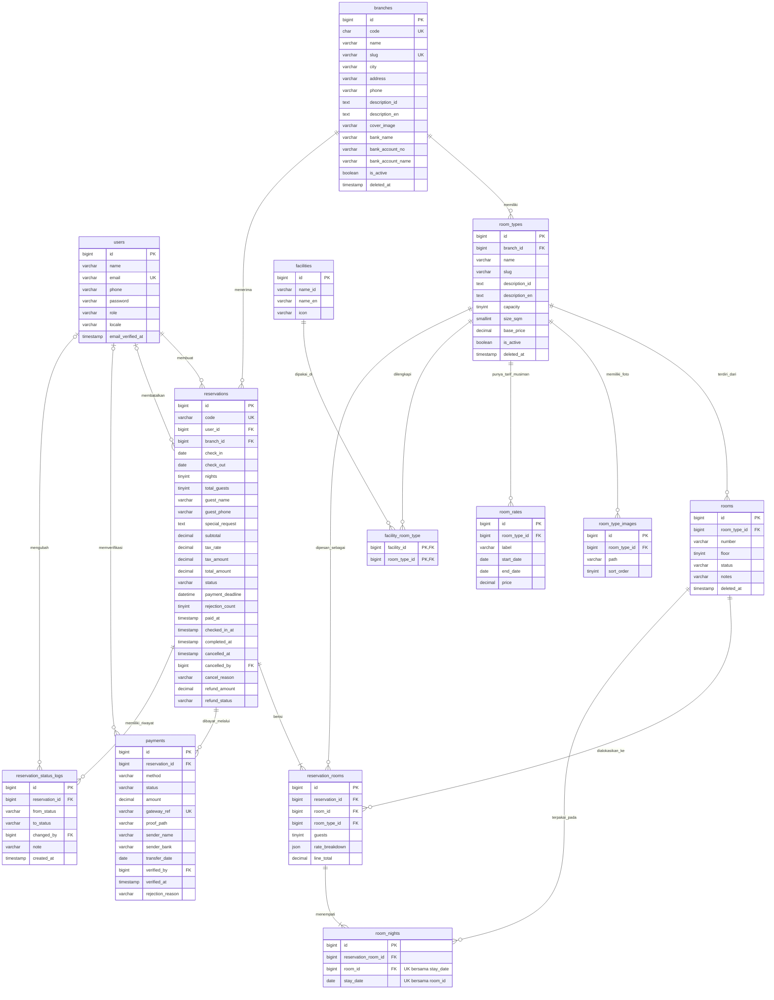

# 03 · Perancangan Basis Data

**Sistem Pemesanan Hotel Multi-Cabang — "Nusa Stay Hotels" (fiktif) · MySQL 8 / MariaDB 10.6+ · InnoDB · utf8mb4**

> 🇮🇩 Bahasa Indonesia · [🇬🇧 English](#-english-version) · ← [02 · Pemodelan](02-pemodelan.md) · → [04 · Wireframe](04-wireframe.md)
>
> Status: **as-built**, sesuai migration di `database/migrations/`. Kamus data memuat kolom **Keterangan (ID)** dan **Description (EN)** sekaligus.

Rancangan memakai pendekatan Entity-Relationship (Chen, 1976) dan dinormalisasi hingga 3NF (Elmasri & Navathe, 2016). Denormalisasi hanya dilakukan secara sengaja untuk *snapshot* historis: `reservation_rooms.room_type_id`, `reservation_rooms.rate_breakdown`, dan `reservations.tax_rate`.

---

## 3.1 ERD



### 3.1.1 Relasi & Kardinalitas

| No | Entitas A | Kardinalitas | Entitas B | Keterangan | On delete |
|---|---|---|---|---|---|
| R1 | users | 1 : 0..N | reservations | Pelanggan membuat reservasi | RESTRICT |
| R2 | users | 0..1 : 0..N | reservations (`cancelled_by`) | Pembatal (null = sistem) | SET NULL |
| R3 | users | 0..1 : 0..N | payments (`verified_by`) | Admin pemverifikasi | SET NULL |
| R4 | users | 0..1 : 0..N | reservation_status_logs | Pengubah status (null = sistem) | SET NULL |
| R5 | branches | 1 : 0..N | room_types | Cabang memiliki tipe kamar | RESTRICT (soft delete) |
| R6 | branches | 1 : 0..N | reservations | Satu reservasi satu cabang (BR-03) | RESTRICT |
| R7 | room_types | 1 : 0..N | rooms | Kamar fisik | RESTRICT (soft delete) |
| R8 | room_types | 1 : 0..N | room_type_images | Galeri foto | CASCADE |
| R9 | room_types | 1 : 0..N | room_rates | Tarif musiman | CASCADE |
| R10 | room_types | M : N | facilities | Pivot `facility_room_type` | CASCADE |
| R11 | reservations | 1 : 1..N | reservation_rooms | 1–5 kamar per reservasi | CASCADE |
| R12 | rooms | 1 : 0..N | reservation_rooms | Kamar yang dialokasikan | RESTRICT |
| R13 | room_types | 1 : 0..N | reservation_rooms | Snapshot tipe kamar | RESTRICT |
| R14 | reservation_rooms | 1 : 1..N | room_nights | Satu baris per malam | CASCADE |
| R15 | rooms | 1 : 0..N | room_nights | Kalender keterpakaian | RESTRICT |
| R16 | reservations | 1 : 0..N | payments | Beberapa percobaan bayar, maks. satu `approved` | CASCADE |
| R17 | reservations | 1 : 0..N | reservation_status_logs | Jejak audit (NFR-14) | CASCADE |

---

## 3.2 Kamus Data

**Konvensi:**
- PK `BIGINT UNSIGNED AUTO_INCREMENT`.
- Uang `DECIMAL(12,2)` dalam Rupiah.
- Status/peran disimpan sebagai `VARCHAR` dan divalidasi PHP 8.1 backed enum (menambah status tidak butuh `ALTER TABLE`).
- `created_at`/`updated_at` dibuat otomatis oleh Laravel.
- Tabel bawaan Laravel (`password_reset_tokens`, `sessions`, `cache`, `jobs`, `failed_jobs`) tidak dijabarkan.

### T01 · `users`

| Kolom | Tipe | Null | Kunci | Keterangan (ID) | Description (EN) |
|---|---|---|---|---|---|
| id | BIGINT UNSIGNED | Tidak | PK | ID pengguna | User ID |
| name | VARCHAR(100) | Tidak | | Nama lengkap | Full name |
| email | VARCHAR(150) | Tidak | UK | Email login | Login email |
| phone | VARCHAR(20) | Ya | | Telepon/WhatsApp | Phone/WhatsApp |
| role | VARCHAR(20) | Tidak | IDX | `admin` \| `customer`; default `customer`; tidak dapat diisi lewat form | Role; not mass-assignable |
| locale | VARCHAR(5) | Tidak | | `id` \| `en`; bahasa antarmuka & email | UI and email language |
| email_verified_at | TIMESTAMP | Ya | | Waktu verifikasi email | Email verification time |
| password | VARCHAR(255) | Tidak | | Hash bcrypt | Bcrypt hash |

### T02 · `branches`

| Kolom | Tipe | Null | Kunci | Keterangan (ID) | Description (EN) |
|---|---|---|---|---|---|
| id | BIGINT UNSIGNED | Tidak | PK | ID cabang | Branch ID |
| code | CHAR(3) | Tidak | UK | `JMB`, `UBD`, `SMY`; dipakai di kode reservasi | Used in booking codes |
| name | VARCHAR(100) | Tidak | | Nama cabang | Branch name |
| slug | VARCHAR(120) | Tidak | UK | Slug URL, mis. `nusa-stay-ubud` | URL slug |
| city / address / phone / email | VARCHAR | — | | Kontak cabang | Contact details |
| description_id / description_en | TEXT | Ya | | Deskripsi dwibahasa | Bilingual description |
| cover_image | VARCHAR(255) | Ya | | Path foto (storage publik) | Photo path |
| bank_name / bank_account_no / bank_account_name | VARCHAR | Tidak | | Rekening tujuan transfer | Transfer account |
| is_active | TINYINT(1) | Tidak | IDX | Tampil di pencarian | Shown in search |
| deleted_at | TIMESTAMP | Ya | | Soft delete (BR-19) | Soft delete |

### T03 · `room_types`

| Kolom | Tipe | Null | Kunci | Keterangan (ID) | Description (EN) |
|---|---|---|---|---|---|
| id | BIGINT UNSIGNED | Tidak | PK | ID tipe kamar | Room type ID |
| branch_id | BIGINT UNSIGNED | Tidak | FK | Cabang pemilik | Owning branch |
| name | VARCHAR(100) | Tidak | | Mis. "Deluxe Garden View" | Type name |
| slug | VARCHAR(120) | Tidak | UK (branch_id, slug) | Unik per cabang | Unique per branch |
| description_id / description_en | TEXT | Ya | | Deskripsi dwibahasa | Bilingual description |
| capacity | TINYINT UNSIGNED | Tidak | | Maks. tamu per kamar (BR-04) | Max guests per room |
| size_sqm | SMALLINT UNSIGNED | Ya | | Luas (m²) | Size (m²) |
| base_price | DECIMAL(12,2) | Tidak | | Tarif dasar per malam (BR-07) | Base nightly rate |
| is_active / deleted_at | — | — | | Aktif / soft delete | Active / soft delete |

### T04 · `room_type_images`

| Kolom | Tipe | Kunci | Keterangan (ID) | Description (EN) |
|---|---|---|---|---|
| id | BIGINT UNSIGNED | PK | ID foto | Image ID |
| room_type_id | BIGINT UNSIGNED | FK (CASCADE) | Tipe kamar | Room type |
| path | VARCHAR(255) | | Path di storage publik | Public storage path |
| sort_order | TINYINT UNSIGNED | | 0 = foto utama | 0 = main photo |

### T05 · `rooms`

| Kolom | Tipe | Null | Kunci | Keterangan (ID) | Description (EN) |
|---|---|---|---|---|---|
| id | BIGINT UNSIGNED | Tidak | PK | ID kamar fisik | Physical room ID |
| room_type_id | BIGINT UNSIGNED | Tidak | FK, IDX (room_type_id, status) | Tipe kamar | Room type |
| number | VARCHAR(10) | Tidak | UK (room_type_id, number) | Nomor kamar; unik per cabang divalidasi aplikasi | Room number; per-branch uniqueness in app |
| floor | TINYINT | Ya | | Lantai | Floor |
| status | VARCHAR(20) | Tidak | | `available` \| `maintenance` \| `inactive` (BR-06) | Room status |
| notes | VARCHAR(255) | Ya | | Catatan internal | Internal notes |
| deleted_at | TIMESTAMP | Ya | | Soft delete | Soft delete |

### T06 · `facilities` & T07 · `facility_room_type`

| Tabel.Kolom | Tipe | Kunci | Keterangan (ID) | Description (EN) |
|---|---|---|---|---|
| facilities.id | BIGINT UNSIGNED | PK | ID fasilitas | Facility ID |
| facilities.name_id / name_en | VARCHAR(50) | | Nama dwibahasa | Bilingual name |
| facilities.icon | VARCHAR(50) | | Kunci ikon | Icon key |
| facility_room_type.facility_id | BIGINT UNSIGNED | PK, FK | Fasilitas | Facility |
| facility_room_type.room_type_id | BIGINT UNSIGNED | PK, FK | Tipe kamar | Room type |

### T08 · `room_rates`

| Kolom | Tipe | Kunci | Keterangan (ID) | Description (EN) |
|---|---|---|---|---|
| id | BIGINT UNSIGNED | PK | ID tarif | Rate ID |
| room_type_id | BIGINT UNSIGNED | FK, IDX (room_type_id, start_date, end_date) | Tipe kamar | Room type |
| label | VARCHAR(50) | | Mis. "Natal & Tahun Baru" | Period label |
| start_date / end_date | DATE | | Rentang inklusif; tidak boleh tumpang tindih per tipe (validasi aplikasi) | Inclusive; no overlap per type |
| price | DECIMAL(12,2) | | Tarif per malam yang menimpa `base_price` | Overriding nightly rate |

### T09 · `reservations`

| Kolom | Tipe | Null | Kunci | Keterangan (ID) | Description (EN) |
|---|---|---|---|---|---|
| id | BIGINT UNSIGNED | Tidak | PK | ID reservasi | Booking ID |
| code | VARCHAR(30) | Tidak | UK | `NSH-JMB-20261119-0001`; dipakai di URL | Booking code; used in URLs |
| user_id | BIGINT UNSIGNED | Tidak | FK, IDX (user_id, created_at) | Pemesan | Customer |
| branch_id | BIGINT UNSIGNED | Tidak | FK, IDX (branch_id, check_in) | Cabang | Branch |
| check_in / check_out | DATE | Tidak | | Tanggal menginap; check-out bukan malam | Stay dates |
| nights / total_guests | TINYINT UNSIGNED | Tidak | | Jumlah malam (1–14) & tamu | Nights & guests |
| guest_name / guest_phone | VARCHAR | Tidak | | Tamu utama | Lead guest |
| special_request | TEXT | Ya | | Permintaan khusus | Special requests |
| subtotal / tax_amount / total_amount | DECIMAL(12,2) | Tidak | | Rincian tagihan | Amounts |
| tax_rate | DECIMAL(5,2) | Tidak | | Snapshot persentase pajak (BR-08) | Tax % snapshot |
| status | VARCHAR(30) | Tidak | IDX (status, payment_deadline) | Lihat state diagram (BR-18) | Booking status |
| payment_deadline | DATETIME | Tidak | | Batas bayar (BR-09, BR-20) | Payment deadline |
| rejection_count | TINYINT UNSIGNED | Tidak | | Jumlah bukti ditolak (BR-11) | Rejected receipts |
| paid_at | TIMESTAMP | Ya | IDX | Dasar laporan pendapatan | Revenue basis |
| checked_in_at / completed_at / cancelled_at | TIMESTAMP | Ya | | Waktu peristiwa | Event times |
| cancelled_by / cancel_reason | — | Ya | FK (SET NULL) | Pembatal & alasan | Canceller & reason |
| refund_amount | DECIMAL(12,2) | Tidak | | Nominal refund (BR-14) | Refund amount |
| refund_status | VARCHAR(20) | Tidak | | `none` \| `pending` \| `processed` | Refund status |

### T10 · `reservation_rooms`

| Kolom | Tipe | Kunci | Keterangan (ID) | Description (EN) |
|---|---|---|---|---|
| id | BIGINT UNSIGNED | PK | ID item | Line item ID |
| reservation_id | BIGINT UNSIGNED | FK (CASCADE) | Reservasi induk | Parent booking |
| room_id | BIGINT UNSIGNED | FK | Kamar fisik yang dialokasikan | Allocated room |
| room_type_id | BIGINT UNSIGNED | FK | Snapshot tipe (denormalisasi sengaja) | Type snapshot |
| guests | TINYINT UNSIGNED | | Tamu di kamar ini (≤ kapasitas) | Guests in room |
| rate_breakdown | JSON | | `[{"date","price","source","label"}]`, snapshot tarif per malam | Nightly rate snapshot |
| line_total | DECIMAL(12,2) | | Jumlah tarif semua malam | Sum of nightly rates |

### T11 · `room_nights` ⭐ buku besar inventaris

| Kolom | Tipe | Kunci | Keterangan (ID) | Description (EN) |
|---|---|---|---|---|
| id | BIGINT UNSIGNED | PK | ID baris | Row ID |
| reservation_room_id | BIGINT UNSIGNED | FK (CASCADE) | Item reservasi pemilik | Owning line item |
| room_id | BIGINT UNSIGNED | FK, **UK (room_id, stay_date)** | Kamar terpakai | Occupied room |
| stay_date | DATE | **UK (room_id, stay_date)**, IDX | Malam menginap, disimpan murni `Y-m-d` | Stay night |

> **Invarian:** baris hanya ada untuk reservasi berstatus Menunggu Pembayaran, Menunggu Verifikasi, Lunas, Check-in, atau Selesai. Baris dihapus dalam transaksi yang sama saat reservasi dibatalkan atau kedaluwarsa. Diverifikasi otomatis oleh test dan skrip integritas data.

### T12 · `payments`

| Kolom | Tipe | Kunci | Keterangan (ID) | Description (EN) |
|---|---|---|---|---|
| id | BIGINT UNSIGNED | PK | ID pembayaran | Payment ID |
| reservation_id | BIGINT UNSIGNED | FK (CASCADE) | Reservasi | Booking |
| method | VARCHAR(20) | | `gateway` \| `bank_transfer` | Method |
| status | VARCHAR(20) | IDX (status, created_at) | `pending`, `submitted`, `approved`, `rejected`, `failed`, `cancelled` | Status |
| amount | DECIMAL(12,2) | | Harus sama dengan total (BR-12) | Must equal total |
| gateway_ref | VARCHAR(64) | UK | Referensi MockPay | Gateway reference |
| proof_path | VARCHAR(255) | | Bukti di storage **privat** (NFR-04) | Private receipt path |
| sender_name / sender_bank / transfer_date | — | | Data pengirim | Sender details |
| verified_by / verified_at | — | FK (SET NULL) | Admin & waktu verifikasi | Verifier & time |
| rejection_reason | VARCHAR(255) | | Alasan penolakan | Rejection reason |

### T13 · `reservation_status_logs`

| Kolom | Tipe | Kunci | Keterangan (ID) | Description (EN) |
|---|---|---|---|---|
| id | BIGINT UNSIGNED | PK | ID log | Log ID |
| reservation_id | BIGINT UNSIGNED | FK (CASCADE) | Reservasi | Booking |
| from_status / to_status | VARCHAR(30) | | Transisi status (from null = baru dibuat) | Status transition |
| changed_by | BIGINT UNSIGNED | FK (SET NULL) | Pengubah; null = sistem | Actor; null = system |
| note | VARCHAR(255) | | Catatan, mis. alasan | Note |
| created_at | TIMESTAMP | | Append-only, tanpa `updated_at` | Append-only |

---

## 3.3 Logika Pengecekan Ketersediaan (Anti-Overbooking)

### 3.3.1 Definisi Irisan Tanggal

Kamar **tidak tersedia** untuk `[check_in_baru, check_out_baru)` bila ada reservasi aktif `[check_in_lama, check_out_lama)` dengan:

```
check_in_baru < check_out_lama   DAN   check_out_baru > check_in_lama
```

Dengan buku besar `room_nights`, kondisi ini setara dengan memeriksa apakah ada `stay_date` pada rentang `check_in_baru ≤ stay_date < check_out_baru`.

```
Tanggal       20   21   22   23   24
Reservasi A   [====A=====)              A: 20 → 22  (malam 20, 21)
Permintaan B            [=====B=====)   B: 22 → 24  ✅ boleh (back-to-back)
Permintaan C       [=====C=====)        C: 21 → 23  ❌ bentrok (malam 21)
```

### 3.3.2 Query Pencarian

Implementasi: `AvailabilityService::searchByBranch()` dan `Room::scopeFreeBetween()`. Bentuk SQL setaranya:

```sql
-- Hitung kamar tersedia per tipe kamar di satu cabang
SELECT rt.id, rt.name, COUNT(r.id) AS available_rooms
FROM room_types rt
JOIN rooms r ON r.room_type_id = rt.id
            AND r.status = 'available' AND r.deleted_at IS NULL      -- BR-06
WHERE rt.branch_id = :branch_id AND rt.is_active = 1 AND rt.deleted_at IS NULL
  AND NOT EXISTS (                                                  -- BR-05
        SELECT 1 FROM room_nights rn
        WHERE rn.room_id = r.id
          AND rn.stay_date >= :check_in AND rn.stay_date < :check_out)
GROUP BY rt.id, rt.name;
```

### 3.3.3 Strategi Tiga Lapis saat Menyimpan (as-built)

Implementasi: `ReservationService::create()`.

| Lapis | Mekanisme | Fungsi | Jika gagal |
|---|---|---|---|
| **1. Mutex per cabang** | `SELECT … FROM branches WHERE id = ? FOR UPDATE` sebagai **pernyataan pertama** transaksi | Transaksi lain untuk cabang yang sama menunggu. Sekaligus menjamin nomor urut kode reservasi unik | Menunggu (timeout InnoDB) |
| **2. Cek ulang** | Query kamar bebas setelah kunci didapat | Membaca data terbaru yang sudah di-commit | `RoomNotAvailableException` → rollback |
| **3. Indeks unik** | `UNIQUE(room_id, stay_date)` di `room_nights` | Jaring pengaman terakhir | `UniqueConstraintViolationException` → `RoomNotAvailableException` |

> **Catatan isolasi:** InnoDB `REPEATABLE READ` membuat snapshot pada pembacaan non-penguncian pertama. Karena itu `branch_id` dibaca **sebelum** transaksi dimulai, dan `FOR UPDATE` menjadi pernyataan pertama di dalam transaksi.
>
> **Perubahan dari rancangan awal:** kunci awalnya direncanakan per tipe kamar. Implementasi memakai kunci per cabang karena satu reservasi selalu satu cabang (BR-03) dan nomor urut kode reservasi dihitung per cabang.

### 3.3.4 Pelepasan Kamar & Kondisi Balapan

| Situasi | Penanganan |
|---|---|
| Kedaluwarsa (scheduler 5 menit) | Per reservasi: lock baris → cek ulang status & batas → hapus `room_nights` → status Kedaluwarsa + log |
| Pembatalan | Satu transaksi: refund, batalkan pembayaran menggantung, hapus `room_nights`, status Dibatalkan |
| Callback gateway & scheduler bersamaan | Keduanya mengunci baris reservasi; yang kedua melihat status sudah berubah |
| Callback sukses setelah kedaluwarsa | `tryReallocate()`: kunci cabang, cek kamar yang sama masih bebas → aktifkan kembali sebagai Lunas; bila tidak, refund 100% ditandai |
| Dua admin menyetujui bukti yang sama | Lock reservasi lalu payment, lalu cek `status = submitted` |
| Menunggu Verifikasi | Tidak ikut kedaluwarsa (BR-10) |

### 3.3.5 Kasus Uji & Hasil

| ID | Skenario | Diharapkan | Hasil |
|---|---|---|---|
| TC-AV-01 | Back-to-back (check-out = check-in) | Berhasil | ✅ Lulus |
| TC-AV-02 | Irisan sebagian | Ditolak | ✅ Lulus |
| TC-AV-03 | Rentang membungkus | Ditolak | ✅ Lulus |
| TC-AV-04 | Kamar perawatan | Tidak dihitung | ✅ Lulus |
| TC-AV-05 | Kedaluwarsa melepas kamar | Bisa dipesan lagi | ✅ Lulus |
| TC-AV-06 | Pembatalan melepas kamar | Bisa dipesan lagi | ✅ Lulus |
| TC-AV-07a | Lapis 2 disimulasikan gagal (mock) | Lapis 3 menolak, rollback penuh | ✅ Lulus |
| TC-AV-07b | **Konkurensi nyata**: 20 proses, 4 kamar (`hotel:concurrency-test`, MySQL) | Tepat 4 berhasil, 0 malam ganda | ✅ Lulus (lokal MariaDB & CI MySQL 8) |
| TC-AV-08 | Insert manual `room_nights` duplikat | Galat unique constraint | ✅ Lulus |

---

## 3.4 Definisi Metrik Laporan

Implementasi: `ReportService` (kompatibel MySQL & SQLite).

| Metrik | Rumus |
|---|---|
| Malam-kamar terjual | Jumlah `room_nights` pada periode dari reservasi Lunas/Check-in/Selesai |
| Malam-kamar tersedia | Jumlah kamar selain `inactive` × jumlah hari |
| **Okupansi** | terjual ÷ tersedia × 100; gabungan = Σ terjual ÷ Σ tersedia (bukan rata-rata persentase) |
| **Pendapatan bersih** | Σ(`total_amount` − `refund_amount`) berdasarkan `paid_at` (basis kas) |
| Kamar terlaris | Peringkat tipe kamar berdasarkan malam-kamar terjual |

## Referensi

- Chen, P. P.-S. (1976). The entity-relationship model—Toward a unified view of data. *ACM Transactions on Database Systems, 1*(1), 9–36. https://doi.org/10.1145/320434.320440
- Elmasri, R., & Navathe, S. B. (2016). *Fundamentals of database systems* (7th ed.). Pearson.
- Oracle. (2024). *MySQL 8.0 reference manual: Locking reads*. https://dev.mysql.com/doc/refman/8.0/en/innodb-locking-reads.html

---

## 🇬🇧 English Version

**ERD and data dictionary.** Shared above. Every dictionary table has a *Description (EN)* column. Relationship labels translate as: membuat = creates · membatalkan = cancels · memverifikasi = verifies · memiliki = has · menerima = receives · terdiri_dari = consists of · dilengkapi = equipped with · berisi = contains · dialokasikan_ke = allocated to · menempati = occupies · dibayar_melalui = paid via · memiliki_riwayat = has history.

**Conventions:**
- `BIGINT UNSIGNED` primary keys.
- `DECIMAL(12,2)` money, in Rupiah.
- Statuses stored as `VARCHAR` and validated by PHP backed enums.
- Intentional denormalization only for historical snapshots: the type snapshot, the rate snapshot, and the tax rate.

**Availability.** A room is unavailable for `[new_in, new_out)` if any `room_nights.stay_date` falls in that half-open range, so back-to-back stays are allowed.

**Three-layer protection (as built, in `ReservationService::create()`):**
1. `SELECT … FOR UPDATE` on the branch row as the first statement of the transaction. The branch id is read before the transaction so no snapshot is taken first. This also serialises per-branch booking-code sequences.
2. Re-check free rooms after acquiring the lock.
3. `UNIQUE(room_id, stay_date)` as the final safety net, mapped to `RoomNotAvailableException`.

The original design locked per room type. The implementation locks per branch because a booking always belongs to one branch.

**Release & races:**
- Expiry and cancellation delete `room_nights` in the same transaction as the status change.
- Concurrent callback and scheduler are serialised by row locks.
- A late successful callback triggers re-allocation, or a full-refund flag.
- Double approval is prevented by locking and re-checking `submitted`.

**Tests:** all TC-AV cases pass, including a real 20-process concurrency test (exactly 4 of 4 rooms sold, 0 duplicate nights) on local MariaDB and on MySQL 8 in CI.

**Report metrics:**
- Occupancy = sold ÷ available room-nights; consolidated = Σ sold ÷ Σ available.
- Net revenue = Σ(total − refund) by payment date (cash basis).
- Best-sellers are ranked by room-nights sold.
