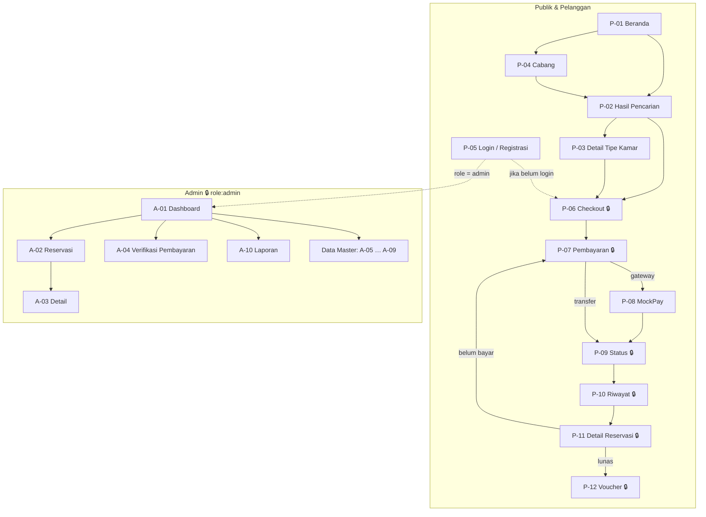

# 04 · Wireframe & Panduan Antarmuka

**Sistem Pemesanan Hotel Multi-Cabang — "Nusa Stay Hotels" (fiktif)**

> 🇮🇩 Bahasa Indonesia · [🇬🇧 English](#-english-version) · ← [03 · Basis Data](03-basis-data.md)
>
> Wireframe *low-fidelity* (ASCII) yang menjadi acuan implementasi. Tampilan akhir hasil implementasi dapat dilihat di [`screenshots/`](screenshots/). Wireframe paling rapi dibaca dengan font monospace.

---

## 4.1 Daftar Halaman

### 4.1.1 Publik & Pelanggan

| ID | Halaman | Rute | Akses | UC / FR |
|---|---|---|---|---|
| P-01 | Beranda | `GET /` | Publik | UC-05 · FR-06 |
| P-02 | Hasil Pencarian | `GET /search` | Publik | UC-05 · FR-06 |
| P-03 | Detail Tipe Kamar | `GET /branches/{branch}/rooms/{roomType}` | Publik | UC-06 · FR-07, FR-08 |
| P-04 | Daftar & Detail Cabang | `GET /branches`, `/branches/{branch}` | Publik | FR-06 |
| P-05 | Login, Registrasi, Lupa Sandi, Verifikasi Email | Breeze | Tamu | UC-01, UC-02 |
| P-06 | Checkout (Data Tamu) | `GET/POST /checkout` | Pelanggan terverifikasi | UC-07 · FR-08–FR-11 |
| P-07 | Pembayaran | `GET /reservations/{code}/payment` | Pemilik | UC-09–UC-11 |
| P-08 | MockPay (simulasi gateway) | `GET/POST /mockpay/{ref}` | Pemilik | UC-10 · FR-13 |
| P-09 | Status Pembayaran | `GET /reservations/{code}/payment/status` | Pemilik | FR-13, FR-14 |
| P-10 | Riwayat Pesanan | `GET /reservations` | Pelanggan | UC-12 · FR-19 |
| P-11 | Detail Reservasi + modal pembatalan | `GET /reservations/{code}` | Pemilik | UC-13 · FR-20 |
| P-12 | Voucher (cetak/PDF) | `GET /reservations/{code}/voucher` | Pemilik, status Lunas | UC-14 · FR-18 |
| P-13 | Profil | `GET /profile` | Pelanggan | UC-04 · FR-04 |

### 4.1.2 Admin (`/admin`, middleware `role:admin`)

| ID | Halaman | Rute | UC / FR |
|---|---|---|---|
| A-01 | Dashboard | `/admin` | UC-21 · FR-30 |
| A-02 | Daftar Reservasi | `/admin/reservations` | UC-20 · FR-28 |
| A-03 | Detail Reservasi (check-in/out, batal) | `/admin/reservations/{code}` | UC-13, UC-20 · FR-21, FR-29 |
| A-04 | Verifikasi Pembayaran | `/admin/payments` | UC-15 · FR-15 |
| A-05 | Cabang | `/admin/branches` | UC-16 · FR-22 |
| A-06 | Tipe Kamar (info, foto, fasilitas) | `/admin/room-types` | UC-17 · FR-23, FR-25 |
| A-07 | Kamar | `/admin/rooms` | UC-18 · FR-24 |
| A-08 | Fasilitas | `/admin/facilities` | UC-17 · FR-25 |
| A-09 | Tarif Musiman | `/admin/room-rates` | UC-19 · FR-26 |
| A-10 | Laporan (4 tab, ekspor CSV, versi cetak) | `/admin/reports` | UC-22 · FR-31–FR-35 |

**Halaman sistem:** 403, 404, 419 (sesi kedaluwarsa, dengan tombol muat ulang), 500.

### 4.1.3 Peta Situs



---

## 4.2 Wireframe Halaman Utama

**Tata letak global:**
- **Pelanggan:** navbar atas (logo, Cabang, Pesanan Saya, `[ID|EN]`, akun), konten, lalu footer. Di layar < 768 px, menu menjadi ☰.
- **Admin:** sidebar kiri (drawer di layar < 1024 px), bar atas (judul, filter, `[ID|EN]`), lalu konten.

### W-01 · Beranda (desktop)

```text
┌────────────────────────────────────────────────────────────────────────────┐
│ [≋ Nusa Stay]   Cabang   Tentang   Pesanan Saya        [ID|EN]   [Masuk]   │
├────────────────────────────────────────────────────────────────────────────┤
│                                                                            │
│ ░░░░░░░░░░░░░░░░░░░  FOTO HERO (pantai saat senja)  ░░░░░░░░░░░░░░░░░░░    │
│         Menginap di Bali: tiga suasana, satu pemesanan.                    │
│                                                                            │
│ ┌────────────────────────────────────────────────────────────────────────┐ │
│ │ Cabang          Check-in       Check-out      Tamu    Kamar            │ │
│ │ [Jimbaran ▾]   [19/11/2026]   [21/11/2026]   [2 ▾]   [1 ▾]   [  CARI  ]│ │
│ └────────────────────────────────────────────────────────────────────────┘ │
│                                                                            │
│ Pilih Cabang Kami                                                          │
│  ┌────────────────────┐   ┌────────────────────┐   ┌────────────────────┐  │
│  │ ░░░░ foto ░░░░░░░  │   │ ░░░░ foto ░░░░░░░  │   │ ░░░░ foto ░░░░░░░  │  │
│  │ Jimbaran           │   │ Ubud               │   │ Seminyak           │  │
│  │ Tepi pantai        │   │ Hutan & sawah      │   │ Pusat gaya hidup   │  │
│  │ mulai Rp850.000    │   │ mulai Rp650.000    │   │ mulai Rp750.000    │  │
│  │ [Lihat kamar →]    │   │ [Lihat kamar →]    │   │ [Lihat kamar →]    │  │
│  └────────────────────┘   └────────────────────┘   └────────────────────┘  │
│                                                                            │
│ Mengapa memesan langsung?                                                  │
│ [+] Harga resmi terbaik   [+] Konfirmasi instan   [+] Pembatalan fleksibel │
├────────────────────────────────────────────────────────────────────────────┤
│ © 2026 Nusa Stay Hotels (fiktif) · Kontak · Kebijakan Pembatalan · FAQ     │
└────────────────────────────────────────────────────────────────────────────┘
```

### W-01m · Beranda (mobile)

```text
┌──────────────────────────┐
│ ≋ Nusa Stay  [ID] [☰]    │
├──────────────────────────┤
│ ░░░░ FOTO HERO ░░░░░░    │
│ Menginap di Bali...      │
│                          │
│ ┌──────────────────────┐ │
│ │Cabang  [Jimbaran   ▾]│ │
│ │Check-in  [19/11/2026]│ │
│ │Check-out [21/11/2026]│ │
│ │Tamu [2▾]   Kamar [1▾]│ │
│ │ [       CARI       ] │ │
│ └──────────────────────┘ │
│                          │
│ ┌──────────────────────┐ │
│ │ ░ foto ░  Jimbaran   │ │
│ │ mulai Rp850.000  [→] │ │
│ └──────────────────────┘ │
│ (kartu cabang            │
│   ditumpuk vertikal)     │
└──────────────────────────┘
```

| Komponen | Perilaku | Acuan |
|---|---|---|
| Form pencarian | Tanggal lampau & > 365 hari dinonaktifkan; default besok–lusa | BR-01, BR-02 |
| Kartu cabang | "mulai Rp…" = tarif dasar termurah | FR-06 |
| `[ID\|EN]` | Menyimpan pilihan di sesi & profil, kembali ke halaman yang sama | FR-05 |

### W-02 · Hasil Pencarian

```text
┌────────────────────────────────────────────────────────────────────────────┐
│ [≋ Nusa Stay]   Cabang   Tentang   Pesanan Saya        [ID|EN]   [Masuk]   │
├────────────────────────────────────────────────────────────────────────────┤
│ [Jimbaran ▾] [19/11/2026] → [21/11/2026] · 2 malam  [2 tamu ▾] [1 kamar ▾] │
│                                                           [Ubah Pencarian] │
├────────────────────────────────────────────────────────────────────────────┤
│ FILTER (opsional)  │ 3 tipe kamar tersedia di Jimbaran                     │
│                    │ ┌───────────────────────────────────────────────────┐ │
│ Urutkan            │ │ ░░░░░░░░ │ Deluxe Garden View        [!] Sisa 2   │ │
│ (•) Harga termurah │ │ ░ foto ░ │ maks 2 tamu · 32 m²                    │ │
│ ( ) Harga termahal │ │ ░░░░░░░░ │ AC · Wi-Fi · Balkon · +3 lainnya       │ │
│ ( ) Kapasitas      │ │          │ Rp1.200.000 /malam                     │ │
│                    │ │          │ Total 2 malam: Rp2.904.000 *           │ │
│ Kapasitas          │ │          │ [Detail]           [Pesan Sekarang]    │ │
│ [ ] 2 [ ] 3 [ ] 4+ │ └───────────────────────────────────────────────────┘ │
│                    │ ┌───────────────────────────────────────────────────┐ │
│ Fasilitas          │ │ ░ foto ░ │ Ocean Suite              Sisa 5        │ │
│ [ ] Kolam pribadi  │ │          │ maks 3 tamu · 48 m² · Rp2.100.000/mlm  │ │
│ [ ] Bathtub        │ │          │ [Detail]           [Pesan Sekarang]    │ │
│ [ ] Dapur kecil    │ └───────────────────────────────────────────────────┘ │
│                    │ * termasuk pajak & layanan 21%                        │
│                    │ ┌╌╌╌╌╌╌╌╌╌╌╌╌╌╌╌╌╌╌╌╌╌╌╌╌╌╌╌╌╌╌╌╌╌╌╌╌╌╌╌╌╌╌╌╌╌╌╌╌╌╌╌┐ │
│                    │ ╎ Pool Villa — HABIS pada tanggal ini (redup)       ╎ │
│                    │ └╌╌╌╌╌╌╌╌╌╌╌╌╌╌╌╌╌╌╌╌╌╌╌╌╌╌╌╌╌╌╌╌╌╌╌╌╌╌╌╌╌╌╌╌╌╌╌╌╌╌╌┘ │
└────────────────────────────────────────────────────────────────────────────┘
```

**Keadaan kosong (W-02e):**

```text
┌──────────────────────────────────────────────────────────────────────────┐
│                                                                          │
│   (i) Tidak ada kamar tersedia di Jimbaran untuk 24–26 Des 2026.         │
│                                                                          │
│   Tersedia di cabang lain pada tanggal yang sama:                        │
│     • Ubud      — 4 tipe kamar          [Lihat Ubud →]                   │
│     • Seminyak  — 1 tipe kamar          [Lihat Seminyak →]               │
│                                                                          │
│   [Ubah tanggal]                                                         │
│                                                                          │
└──────────────────────────────────────────────────────────────────────────┘
```

| Komponen | Perilaku | Acuan |
|---|---|---|
| Label "Sisa n" | Tampil bila sisa ≤ 3 kamar, dihitung dari data nyata | FR-07 |
| Total estimasi | Sudah termasuk tarif musiman & pajak 21% | FR-08, BR-07, BR-08 |
| Tipe habis | Tetap tampil redup tanpa tombol pesan | — |

### W-03 · Detail Tipe Kamar

```text
┌────────────────────────────────────────────────────────────────────────────┐
│ [≋ Nusa Stay]   Cabang   Tentang   Pesanan Saya        [ID|EN]   [Masuk]   │
├────────────────────────────────────────────────────────────────────────────┤
│ Beranda › Jimbaran › Deluxe Garden View                                    │
│                                                                            │
│ ┌──────────────────────────────────┐  ┌───────────────────────────────────┐│
│ │                                  │  │ Deluxe Garden View                ││
│ │                                  │  │ Nusa Stay Jimbaran                ││
│ │        FOTO UTAMA (galeri)       │  │ maks 2 tamu · 32 m²               ││
│ │    [‹]                       [›] │  │ ────────────────────────────────  ││
│ │                                  │  │ 19 → 21 Nov 2026 · 2 malam  [ubah]││
│ │                                  │  │ Jumlah kamar  [−] 1 [+]   (sisa 2)││
│ └──────────────────────────────────┘  │ Tamu          [2 ▾]               ││
│ [▫] [▫] [▫] [▫]   ← thumbnail         │ ────────────────────────────────  ││
│                                       │ 19 Nov (Kam)          Rp1.200.000 ││
│ Deskripsi                             │ 20 Nov (Jum)          Rp1.200.000 ││
│ Kamar menghadap taman tropis,         │ Pajak & layanan 21%     Rp504.000 ││
│ tempat tidur king, balkon pribadi.    │ TOTAL                 Rp2.904.000 ││
│                                       │                                   ││
│ Fasilitas                             │ [       PESAN SEKARANG         ]  ││
│ AC · Wi-Fi · TV · Shower air panas    │ Batal gratis s.d. 12 Nov 2026     ││
│ Balkon · Teh/kopi · Brankas           └───────────────────────────────────┘│
│                                                                            │
│ Ketentuan                                                                  │
│ Check-in 14.00 · Check-out 12.00                                           │
│                                                                            │
│ Kebijakan pembatalan: ≥ 7 hari 100% · 3–6 hari 50% · < 3 hari 0%           │
└────────────────────────────────────────────────────────────────────────────┘
```

| Komponen | Perilaku | Acuan |
|---|---|---|
| Panel pemesanan | *Sticky*; rincian tarif per malam (malam musiman berlabel) | BR-07 |
| "Batal gratis s.d." | Check-in − 7 hari | BR-14 |

### W-04 · Checkout

```text
┌────────────────────────────────────────────────────────────────────────────┐
│ [≋ Nusa Stay]   Cabang   Tentang   Pesanan Saya        [ID|EN]   [Masuk]   │
├────────────────────────────────────────────────────────────────────────────┤
│ (1) Pilih Kamar ──── [2] Data Tamu ──── (3) Pembayaran ──── (4) Selesai    │
│                                                                            │
│ ┌────────────────────────────────────────┐  ┌─────────────────────────────┐│
│ │ Data Tamu Utama                        │  │ RINGKASAN PESANAN           ││
│ │ Nama lengkap*  [Budi Santoso          ]│  │ ░ foto ░ Deluxe Garden View ││
│ │ No. telepon*   [+62 812 xxxx xxxx     ]│  │ Nusa Stay Jimbaran          ││
│ │ [x] Isi otomatis dari profil saya      │  │ 19 → 21 Nov 2026 (2 malam)  ││
│ │                                        │  │ 1 kamar · 2 tamu            ││
│ │ Kamar 1 — Deluxe Garden View           │  │ ──────────────────────────  ││
│ │ Jumlah tamu*   [2 ▾]  (maks 2)         │  │ Subtotal       Rp2.400.000  ││
│ │                                        │  │ Pajak & lay. 21% Rp504.000  ││
│ │ Permintaan khusus (opsional)           │  │ TOTAL          Rp2.904.000  ││
│ │ [Lantai atas bila mungkin]             │  │ ──────────────────────────  ││
│ │                                        │  │ Bayar maks. 24 jam setelah  ││
│ │ [ ] Saya menyetujui Kebijakan          │  │ konfirmasi pesanan          ││
│ │     Pembatalan & Ketentuan Menginap*   │  └─────────────────────────────┘│
│ │                                        │                                 │
│ │ [← Kembali]      [KONFIRMASI PESANAN]  │                                 │
│ └────────────────────────────────────────┘                                 │
└────────────────────────────────────────────────────────────────────────────┘
```

**Banner bila kamar habis saat disimpan (W-04e):**

```text
┌──────────────────────────────────────────────────────────────────────────┐
│ [!] Maaf, kamar Deluxe Garden View baru saja habis dipesan tamu lain.    │
│     Ketersediaan terbaru sudah ditampilkan.   [Lihat kamar lain]   [×]   │
└──────────────────────────────────────────────────────────────────────────┘
```

| Komponen | Perilaku | Acuan |
|---|---|---|
| Stepper 4 langkah | Posisi pengguna dalam alur | NFR-09 |
| Tamu per kamar | Dropdown 1…kapasitas | BR-04 |
| Tombol konfirmasi | Nonaktif sampai kebijakan disetujui; terkunci setelah diklik (anti double-submit) | NFR-07 |

### W-05 · Pembayaran

```text
┌────────────────────────────────────────────────────────────────────────────┐
│ [≋ Nusa Stay]   Cabang   Tentang   Pesanan Saya        [ID|EN]   [Masuk]   │
├────────────────────────────────────────────────────────────────────────────┤
│ (1) ──── (2) ──── [3] Pembayaran ──── (4)                                  │
│                                                                            │
│ ┌────────────────────────────────────────────────────────────────────────┐ │
│ │ Kode Reservasi : NSH-JMB-20261119-0001     [Menunggu Pembayaran]       │ │
│ │ Total tagihan  : Rp2.904.000                                           │ │
│ │ Selesaikan pembayaran dalam   23 : 41 : 07                             │ │
│ │ (batas: 20 Nov 2026, 10.15 WITA)                                       │ │
│ └────────────────────────────────────────────────────────────────────────┘ │
│                                                                            │
│ Pilih metode pembayaran                                                    │
│ ┌──────────────────────────────────┐  ┌──────────────────────────────────┐ │
│ │ (•) Payment Gateway (Simulasi)   │  │ ( ) Transfer Bank Manual         │ │
│ │     Kartu / VA / e-wallet tiruan │  │     Unggah bukti transfer        │ │
│ │     Lunas otomatis               │  │     Verifikasi admin ≤ 1×24 jam  │ │
│ └──────────────────────────────────┘  └──────────────────────────────────┘ │
│                                                                            │
│ [      BAYAR SEKARANG      ]                                               │
└────────────────────────────────────────────────────────────────────────────┘
```

**Transfer dipilih + banner penolakan (W-05b):**

```text
┌────────────────────────────────────────────────────────────────────────────┐
│ (•) Transfer Bank Manual dipilih                                           │
│                                                                            │
│ ┌────────────────────────────────────────────────────────────────────────┐ │
│ │ [!] Bukti sebelumnya DITOLAK: "Nominal kurang Rp4.000".                │ │
│ │     Sisa kesempatan unggah: 1 · Batas bayar: 20 Nov 2026, 12.40 WITA   │ │
│ └────────────────────────────────────────────────────────────────────────┘ │
│                                                                            │
│ ┌─ Transfer ke ──────────────────────────────────────────────────────────┐ │
│ │ Bank ABC (contoh) · 123 456 7890 · a.n. PT Nusa Stay Jimbaran   [Salin]│ │
│ │ Nominal TEPAT: Rp2.904.000                                     [Salin] │ │
│ └────────────────────────────────────────────────────────────────────────┘ │
│                                                                            │
│ Unggah bukti transfer                                                      │
│ ┌╌╌╌╌╌╌╌╌╌╌╌╌╌╌╌╌╌╌╌╌╌╌╌╌╌╌╌╌╌╌╌╌╌╌╌╌╌╌╌╌╌╌╌╌╌╌╌╌╌╌╌╌╌╌╌╌╌╌╌╌╌╌╌╌╌╌╌╌╌╌╌╌┐ │
│ ╎                                                                        ╎ │
│ ╎             ↑  Seret file ke sini atau [pilih file]                    ╎ │
│ ╎                JPG, PNG, atau PDF · maks 2 MB                          ╎ │
│ ╎                                                                        ╎ │
│ └╌╌╌╌╌╌╌╌╌╌╌╌╌╌╌╌╌╌╌╌╌╌╌╌╌╌╌╌╌╌╌╌╌╌╌╌╌╌╌╌╌╌╌╌╌╌╌╌╌╌╌╌╌╌╌╌╌╌╌╌╌╌╌╌╌╌╌╌╌╌╌╌┘ │
│ Nama pengirim*  [                    ]     Bank pengirim*  [Bank XYZ ▾]    │
│ Tanggal transfer*  [20/11/2026]                                            │
│                                                                            │
│ [      KIRIM BUKTI      ]                                                  │
└────────────────────────────────────────────────────────────────────────────┘
```

**MockPay (P-08):**

```text
┌──────────────────────────────────────────────────────┐
│ MOCKPAY — HALAMAN SIMULASI (bukan pembayaran nyata)  │
│                                                      │
│ Merchant : Nusa Stay Hotels                          │
│ Ref      : MP-8F3A21                                 │
│ Nominal  : Rp2.904.000                               │
│                                                      │
│ [ Simulasikan BERHASIL ]   [ Simulasikan GAGAL ]     │
└──────────────────────────────────────────────────────┘
```

| Komponen | Perilaku | Acuan |
|---|---|---|
| Hitung mundur | Diperbarui tiap detik; halaman dimuat ulang saat habis | BR-09 |
| Unggah bukti | Validasi tipe & ukuran di klien dan server | FR-14, NFR-04 |
| Banner penolakan | Alasan admin + sisa kesempatan | BR-11, BR-20 |

### W-06 · Riwayat Pesanan & Modal Pembatalan

```text
┌────────────────────────────────────────────────────────────────────────────┐
│ [≋ Nusa Stay]   Cabang   Tentang   Pesanan Saya        [ID|EN]   [Masuk]   │
├────────────────────────────────────────────────────────────────────────────┤
│ Pesanan Saya                                                               │
│ [Semua] [Aktif] [Menunggu Bayar] [Selesai] [Dibatalkan]   Cari [kode... ]  │
│ ┌────────────────────────────────────────────────────────────────────────┐ │
│ │ NSH-JMB-20261119-0001                       [Menunggu Pembayaran]      │ │
│ │ Nusa Stay Jimbaran · Deluxe Garden View × 1                            │ │
│ │ 19 → 21 Nov 2026 · 2 malam · Rp2.904.000                               │ │
│ │ Bayar sebelum 20 Nov, 10.15 WITA     [Bayar]  [Detail]  [Batalkan]     │ │
│ └────────────────────────────────────────────────────────────────────────┘ │
│ ┌────────────────────────────────────────────────────────────────────────┐ │
│ │ NSH-UBD-20261002-0014                                     [Lunas]      │ │
│ │ Nusa Stay Ubud · Jungle Villa × 1                                      │ │
│ │ 24 → 27 Des 2026 · 3 malam · Rp7.260.000                               │ │
│ │                                    [Voucher]  [Detail]  [Batalkan]     │ │
│ └────────────────────────────────────────────────────────────────────────┘ │
│ ┌────────────────────────────────────────────────────────────────────────┐ │
│ │ NSH-SMY-20260815-0102                                   [Selesai]      │ │
│ │ Nusa Stay Seminyak · Superior Room × 2 · 15 → 17 Agu 2026              │ │
│ │                                                          [Detail]      │ │
│ └────────────────────────────────────────────────────────────────────────┘ │
│ « 1  2  3 »                                                                │
└────────────────────────────────────────────────────────────────────────────┘
```

```text
┌─ Konfirmasi ─────────────────────────────────────────────────┐
│ Batalkan reservasi NSH-UBD-20261002-0014?                    │
│                                                              │
│ Check-in       : 24 Des 2026 (35 hari lagi)                  │
│ Kebijakan      : ≥ 7 hari sebelum check-in → refund 100%     │
│ Estimasi refund: Rp7.260.000                                 │
│                                                              │
│ Alasan (opsional) [                                    ]     │
│                                                              │
│ Refund diproses manual oleh tim kami maks. 7 hari kerja.     │
│                                                              │
│                               [Tidak]   [Ya, Batalkan]       │
└──────────────────────────────────────────────────────────────┘
```

| Komponen | Perilaku | Acuan |
|---|---|---|
| Tombol kontekstual | [Bayar] hanya Menunggu Pembayaran; [Voucher] hanya Lunas; [Batalkan] hanya status yang boleh | BR-15 |
| Modal | Estimasi refund dihitung server; "Tidak" sebagai tombol aman | BR-14 |

### W-07 · Dashboard Admin

```text
┌────────────────────────────────────────────────────────────────────────────┐
│ ≋ Nusa Stay   │ Dashboard        Cabang [Semua ▾]   [ID|EN]  Admin ▾       │
│    ADMIN      │ ───────────────────────────────────────────────────────────│
│               │ ┌────────────┐ ┌────────────┐ ┌────────────┐ ┌────────────┐│
│ [■] Dashboard │ │ Reservasi  │ │ Check-in   │ │ Check-out  │ │Perlu verif.││
│ [ ] Reservasi │ │ hari ini   │ │ hari ini   │ │ hari ini   │ │ (!) 4      ││
│ [ ] Verifikasi│ │    12      │ │    8       │ │    5       │ │ [Tinjau →] ││
│     Bayar  (4)│ └────────────┘ └────────────┘ └────────────┘ └────────────┘│
│ ── MASTER ──  │ ┌───────────────────────────┐ ┌───────────────────────────┐│
│ [ ] Cabang    │ │ Pendapatan bulan ini      │ │ Okupansi bulan ini        ││
│ [ ] Tipe Kamar│ │ Rp384,2 jt  ▲12% vs lalu  │ │ 74,3%  ▲5 poin            ││
│ [ ] Kamar     │ └───────────────────────────┘ └───────────────────────────┘│
│ [ ] Fasilitas │ ┌─ Pendapatan 6 bln (bar bertumpuk) ──────────────────────┐│
│ [ ] Tarif     │ │ ▇▇ ▇▇ ▇▇ ▇▇ ▇▇ ▇▇    ■ Jimbaran                         ││
│ ── ANALISIS ─ │ │ Jun Jul Agu Sep Okt Nov  ■ Ubud ■ Seminyak              ││
│ [ ] Laporan   │ └─────────────────────────────────────────────────────────┘│
│               │ ┌─ Okupansi 30 hr ──────────┐ ┌─ Terlaris ────────────────┐│
│               │ │    ╱╲_╱‾╲__╱‾╲            │ │ Ocean Suite  ████ 92      ││
│               │ │ 1 Nov ...... 30 Nov       │ │ Jungle Villa ███  71      ││
│               │ └───────────────────────────┘ └───────────────────────────┘│
│               │ Check-in hari ini                                          │
│               │ Kode         Tamu      Cabang   Kamar  Aksi                │
│               │ ...19-0001   Budi S.   JMB      101    [Check-in]          │
│               │ ...19-0003   Ana P.    UBD      204    [Check-in]          │
│               │                                                            │
│               │                                                            │
│ [ ] Keluar    │                                                            │
└────────────────────────────────────────────────────────────────────────────┘
```

| Komponen | Perilaku | Acuan |
|---|---|---|
| Filter cabang | Kosong = gabungan | FR-30–FR-32 |
| Kartu "Perlu verifikasi" | Berwarna peringatan bila ada yang menunggu > 24 jam | BR-11 |
| Grafik Chart.js | Bar bertumpuk pendapatan, garis okupansi, bar tipe terlaris | FR-31–FR-34 |

### W-08 · Kelola Kamar

```text
┌────────────────────────────────────────────────────────────────────────────┐
│ ≋ Nusa Stay   │ Kamar · Jimbaran                       [+ Tambah Kamar]    │
│    ADMIN      │ Cabang [Jimbaran ▾] Tipe [Semua ▾] Status [Semua ▾]        │
│               │ Cari [No. kamar   ]                                        │
│ [ ] Dashboard │                                                            │
│ [ ] Reservasi │ ┌─────┬────────┬────────────────────┬─────────────┬──────┐ │
│ [ ] Verifikasi│ │ No. │ Lantai │ Tipe               │ Status      │ Aksi │ │
│ ── MASTER ──  │ ├─────┼────────┼────────────────────┼─────────────┼──────┤ │
│ [ ] Cabang    │ │ 101 │ 1      │ Deluxe Garden View │ ● Tersedia  │ ✎ ⋯  │ │
│ [ ] Tipe Kamar│ │ 102 │ 1      │ Deluxe Garden View │ ◐ Perawatan │ ✎ ⋯  │ │
│ [■] Kamar     │ │ 201 │ 2      │ Ocean Suite        │ ● Tersedia  │ ✎ ⋯  │ │
│ [ ] Fasilitas │ │ 301 │ 3      │ Pool Villa         │ ○ Nonaktif  │ ✎ ⋯  │ │
│ [ ] Tarif     │ └─────┴────────┴────────────────────┴─────────────┴──────┘ │
│ ── ANALISIS ─ │ Menampilkan 1–15 dari 22                  « 1  2 »         │
│ [ ] Laporan   │                                                            │
└────────────────────────────────────────────────────────────────────────────┘
```

```text
┌─ Tambah / Ubah Kamar ──────────────────────────────────────────┐
│ Cabang*      [Jimbaran ▾]                                      │
│ Tipe kamar*  [Deluxe Garden View ▾]   (difilter per cabang)    │
│ Nomor*       [103   ]      Lantai [1  ]                        │
│ Status*      (•) Tersedia  ( ) Perawatan  ( ) Nonaktif         │
│ Catatan      [                              ]                  │
│                                                                │
│ [!] Kamar ini memiliki 3 reservasi mendatang. Mengubah status  │
│     tidak membatalkannya; pindahkan tamu lewat menu Reservasi. │
│                                                                │
│                                      [Batal]   [Simpan]        │
└────────────────────────────────────────────────────────────────┘
```

| Komponen | Perilaku | Acuan |
|---|---|---|
| Hapus | Ditolak bila kamar punya riwayat reservasi; sarankan Nonaktifkan | FR-27, BR-19 |
| Nomor kamar | Unik per cabang | — |
| Peringatan | Muncul bila kamar dengan reservasi mendatang diubah ke Perawatan/Nonaktif | BR-06 |

### W-09 · Laporan

```text
┌────────────────────────────────────────────────────────────────────────────┐
│ ≋ Nusa Stay   │ Laporan                                                    │
│    ADMIN      │ Periode [01/11/2026]–[30/11/2026] Cabang [Semua ▾]         │
│               │ Kelompok [Harian ▾] [Terapkan]   [CSV] [Excel] [PDF]       │
│ [ ] Dashboard │ [Okupansi] Pendapatan  Reservasi  Kamar Terlaris           │
│ [ ] Reservasi │                                                            │
│ [ ] Verifikasi│ ┌─────────────────────────────────────────────────────────┐│
│ ── MASTER ──  │ │ Okupansi 74,3% │ Pendapatan Rp384,2 jt │ 312 reservasi  ││
│ [ ] Cabang    │ └─────────────────────────────────────────────────────────┘│
│ [ ] Tipe Kamar│ ┌─ Okupansi harian per cabang ────────────────────────────┐│
│ [ ] Kamar     │ │   80%┤  ╱‾‾╲    ╱‾╲      — Jimbaran                     ││
│ [ ] Fasilitas │ │   60%┤_╱    ╲__╱   ╲_    — Ubud                         ││
│ [ ] Tarif     │ │      └──────────────────  — Seminyak                    ││
│ ── ANALISIS ─ │ └─────────────────────────────────────────────────────────┘│
│ [■] Laporan   │ ┌──────────┬───────┬──────────┬──────────┬──────────┐      │
│               │ │ Cabang   │ Kamar │ Malam    │ Malam    │ Okupansi │      │
│               │ │          │       │ tersedia │ terjual  │          │      │
│               │ ├──────────┼───────┼──────────┼──────────┼──────────┤      │
│               │ │ Jimbaran │ 22    │ 660      │ 528      │ 80,0%    │      │
│               │ │ Ubud     │ 18    │ 540      │ 351      │ 65,0%    │      │
│               │ │ Seminyak │ 20    │ 600      │ 459      │ 76,5%    │      │
│               │ ├──────────┼───────┼──────────┼──────────┼──────────┤      │
│               │ │ GABUNGAN │ 60    │ 1.800    │ 1.338    │ 74,3%    │      │
│               │ └──────────┴───────┴──────────┴──────────┴──────────┘      │
└────────────────────────────────────────────────────────────────────────────┘
```

### W-10 · Verifikasi Pembayaran

```text
┌────────────────────────────────────────────────────────────────────────────┐
│ Verifikasi Pembayaran › NSH-SMY-20261118-0007   Menunggu 26 jam (!)        │
│                                                                            │
│ ┌─ Bukti transfer ───────────┐  ┌─ Data tagihan ─────────────────────────┐ │
│ │                            │  │ Pelanggan : Siti A.                    │ │
│ │                            │  │ Cabang    : Seminyak (Bank ABC)        │ │
│ │    [ pratinjau bukti ]     │  │ Tagihan   : Rp1.815.000                │ │
│ │                            │  │ ── Data pengirim ──                    │ │
│ │   [Perbesar]  [Unduh]      │  │ Nama      : Siti Aminah                │ │
│ │                            │  │ Bank/Tgl  : Bank XYZ · 18/11/2026      │ │
│ └────────────────────────────┘  │                                        │ │
│                                 │ [ ] Nominal sesuai tagihan             │ │
│                                 │ [ ] Rekening tujuan benar              │ │
│                                 │ [ ] Bukti terbaca jelas                │ │
│                                 │                                        │ │
│                                 │ [Tolak...]          [Setujui]          │ │
│                                 └────────────────────────────────────────┘ │
│ Unggahan ke-1 dari maks. 3                                                 │
└────────────────────────────────────────────────────────────────────────────┘
```

```text
┌─ Tolak pembayaran ─────────────────────────────────┐
│ Alasan penolakan*                                  │
│ [Nominal kurang] [Tidak terbaca] [Rekening salah]  │
│ [ tulis alasan lain...                     ]       │
│ Sisa kesempatan pelanggan setelah ini: 1           │
│                        [Batal] [Tolak]             │
└────────────────────────────────────────────────────┘
```

| Komponen | Perilaku | Acuan |
|---|---|---|
| Daftar periksa | [Setujui] aktif hanya bila ketiga butir dicentang | Heuristik #5 |
| Penolakan ke-3 | Teks berubah menjadi peringatan pembatalan, tombol merah | BR-11 |
| Pratinjau bukti | Dari rute terotorisasi, bukan URL publik | NFR-04 |

---

## 4.3 Panduan Antarmuka

| Token | Tailwind | Penggunaan |
|---|---|---|
| Primary (`brand`) | `teal-700` / hover `teal-800` | Tombol utama, tautan |
| Accent | `amber-500` | Harga, label "Sisa n" |
| Netral | `slate-50`…`slate-900` | Latar, teks, border |
| Bahaya | `red-600` | Hapus, batalkan, galat |

**Badge status** (selalu teks + warna):

| Status | ID | EN | Warna |
|---|---|---|---|
| `pending_payment` | Menunggu Pembayaran | Awaiting Payment | amber |
| `awaiting_verification` | Menunggu Verifikasi | Awaiting Verification | sky |
| `paid` | Lunas | Paid | emerald |
| `checked_in` | Check-in | Checked-in | indigo |
| `completed` | Selesai | Completed | slate |
| `cancelled` | Dibatalkan | Cancelled | red |
| `expired` | Kedaluwarsa | Expired | zinc |

**Tipografi & lokal:**
- Font Inter.
- Breakpoint default Tailwind.
- Uang `Rp1.200.000` / `IDR 1,200,000`, tanggal `19 Nov 2026` / `Nov 19, 2026`, dan angka `1.770` / `1,770` lewat helper `money()`, `date_local()`, dan `num()`.
- Zona waktu WITA ditampilkan pada batas bayar.

**Pemetaan heuristik** (Nielsen, 1994) **dan aksesibilitas** (W3C, 2023):

| Heuristik / prinsip | Penerapan |
|---|---|
| #1 Visibilitas status | Stepper, hitung mundur, badge status, badge antrean verifikasi |
| #3 Kendali pengguna | Tombol kembali, ubah pencarian di tempat, pembatalan |
| #4 Konsistensi | Satu layout per peran, warna status seragam |
| #5 Pencegahan kesalahan | Tanggal invalid dinonaktifkan, tombol terkunci setelah diklik, daftar periksa verifikasi, modal konfirmasi |
| #6 Mengenali > mengingat | Ringkasan pesanan & bar pencarian selalu terlihat |
| #9 Pulih dari kesalahan | "Kamar baru saja habis" + alternatif; alasan penolakan + sisa kesempatan |
| WCAG 2.2 | Label pada semua input, fokus keyboard terlihat, status tidak hanya warna, teks alternatif grafik |

## Referensi

- Nielsen, J. (1994). Enhancing the explanatory power of usability heuristics. In *Proceedings of the SIGCHI Conference on Human Factors in Computing Systems* (pp. 152–158). ACM. https://doi.org/10.1145/191666.191729
- World Wide Web Consortium. (2023). *Web Content Accessibility Guidelines (WCAG) 2.2*. https://www.w3.org/TR/WCAG22/

---

## 🇬🇧 English Version

The wireframes, tables, and sitemap above are shared by both versions.

**Pages:**
- 13 public/customer pages: home, search, room details, branches, auth, checkout, payment, MockPay, payment status, history, booking details, voucher, profile.
- 10 admin pages: dashboard, bookings, booking details, payment verification, branches, room types, rooms, facilities, seasonal rates, reports.
- 4 system pages: 403, 404, 419, 500.

**Wireframe label glossary:**

| Indonesian | English | Indonesian | English |
|---|---|---|---|
| Cabang | Branch | Pesanan Saya | My Bookings |
| Masuk / Daftar | Log in / Register | CARI | SEARCH |
| Pilih Cabang Kami | Choose Our Branch | mulai … / malam | from … / night |
| Pesan Sekarang | Book Now | HABIS | SOLD OUT |
| Sisa n | n left | Batal gratis s.d. | Free cancellation until |
| Data Tamu Utama | Lead Guest Details | KONFIRMASI PESANAN | CONFIRM BOOKING |
| Ringkasan Pesanan | Booking Summary | Selesaikan pembayaran dalam | Complete payment within |
| Transfer ke | Transfer to | Nominal TEPAT | EXACT amount |
| Unggah bukti transfer | Upload transfer receipt | KIRIM BUKTI | SUBMIT RECEIPT |
| Simulasikan BERHASIL/GAGAL | Simulate SUCCESS/FAILURE | Estimasi refund | Estimated refund |
| Perlu verifikasi | Needs verification | Okupansi | Occupancy |
| Pendapatan | Revenue | Terlaris | Best-sellers |
| Malam tersedia / terjual | Room-nights available / sold | GABUNGAN | CONSOLIDATED |
| Setujui / Tolak | Approve / Reject | Alasan penolakan | Rejection reason |

**Key behaviours:**
- Dates outside the allowed range are disabled.
- The "n left" badge shows when ≤ 3 rooms remain.
- Sold-out types appear dimmed.
- The booking panel is sticky, with a per-night breakdown.
- The checkout button locks after one click.
- The payment countdown reloads the page when time runs out.
- Receipt uploads are validated on both client and server.
- The cancellation modal shows a server-computed refund.
- Approval requires a three-item checklist, and the 3rd rejection warns of cancellation.
- Deleting master data with booking history is refused.

**UI guidelines:**
- Teal primary, amber accent.
- Seven bilingual status badges, always text plus colour.
- Inter font.
- Locale-aware money, date, and number helpers.
- Checked against Nielsen's heuristics (Nielsen, 1994) and WCAG 2.2 (W3C, 2023).
