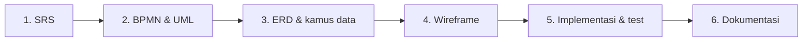

# Studi Kasus: Sistem Pemesanan Hotel Multi-Cabang "Nusa Stay Hotels"

> 🇮🇩 Bahasa Indonesia · [🇬🇧 English](#-english-version)
>
> Studi kasus fiktif untuk portofolio. Semua data, nama hotel, dan angka bisnis bersifat ilustratif. Angka pada bagian **Hasil** berasal dari pengujian aplikasi, bukan dari operasional hotel nyata.

| | |
|---|---|
| **Peran** | System Analyst & Full-Stack Developer (individu) |
| **Lingkup** | Analisis kebutuhan → pemodelan proses → desain basis data → wireframe → implementasi → pengujian → dokumentasi |
| **Teknologi** | Laravel 13, MySQL 8, Blade + Tailwind CSS, Alpine.js, Chart.js, PHPUnit, GitHub Actions |
| **Repositori** | [github.com/romanussudimin-debu/Sistem-Pemesanan-Hotel](https://github.com/romanussudimin-debu/Sistem-Pemesanan-Hotel) |

---

## 1. Masalah

Nusa Stay Hotels adalah jaringan hotel dengan tiga cabang di Bali (Jimbaran, Ubud, Seminyak). Pemesanan masih diterima lewat telepon dan WhatsApp, lalu dicatat resepsionis di buku atau spreadsheet yang berbeda di tiap cabang. Akibatnya:

| # | Masalah | Dampak |
|---|---|---|
| P1 | Ketersediaan kamar tidak terpusat dan tidak real-time | **Pemesanan ganda (overbooking)**, tamu kecewa |
| P2 | Bukti transfer dicek manual lewat chat | Verifikasi lambat, bukti tercecer |
| P3 | Reservasi yang tidak dibayar tidak punya batas waktu | Kamar "terkunci" tanpa kepastian, okupansi turun |
| P4 | Tamu tidak bisa mengecek ketersediaan sendiri | Bergantung pada jam kerja staf |
| P5 | Laporan pendapatan & okupansi direkap manual per cabang | Laporan terlambat dan rawan salah hitung |

**Pertanyaan kunci:** bagaimana membuat satu sistem yang menjamin kamar tidak pernah terjual dua kali, mempercepat pembayaran, dan memberi manajemen data real-time untuk ketiga cabang?

## 2. Peran Saya

Saya mengerjakan proyek ini sendiri, dengan dua peran:

- **System/Business Analyst:** menyusun SRS (kebutuhan fungsional, non-fungsional, dan aturan bisnis), memodelkan proses as-is dan to-be (BPMN), membuat use case beserta skenarionya, activity, sequence, class, dan state diagram, merancang ERD dan kamus data, serta membuat wireframe.
- **Full-Stack Developer:** mengimplementasikan rancangan tersebut menjadi aplikasi Laravel, menulis test otomatis, menyiapkan CI, dan menyusun dokumentasi.

## 3. Proses Analisis

Pekerjaan dibagi dalam enam tahap. Setiap tahap ditutup dengan ringkasan dan daftar asumsi sebelum lanjut, meniru pola *sign-off* dengan pemangku kepentingan.

**Tahap 1: Analisis kebutuhan (SRS).** Struktur mengacu pada ISO/IEC/IEEE 29148, dan atribut kualitas pada ISO/IEC 25010. Hasilnya:
- **35 kebutuhan fungsional** (FR-01 s.d. FR-35) dalam 7 kelompok;
- **14 kebutuhan non-fungsional** dengan ukuran penerimaan yang bisa diuji (mis. "dua pemesanan bersamaan untuk kamar terakhir tidak boleh sama-sama berhasil");
- **20 aturan bisnis**: batas bayar 24 jam/2 jam, refund 100%/50%/0% berdasarkan jarak hari ke check-in, maksimal 14 malam, dan lain-lain.

**Tahap 2: Pemodelan proses & sistem.**
- **BPMN as-is vs to-be:** lima titik masalah manual dipetakan ke solusi sistem.
- **24 use case** dengan relasi «include»/«extend», dan **skenario lengkap** (*fully dressed*) untuk 5 use case utama.
- **Activity, sequence, class, dan state diagram.** State diagram menjadi satu-satunya acuan perubahan status reservasi.

Pemodelan detail memunculkan kasus tepi yang tidak terlihat di SRS. Contohnya: *bagaimana jika admin baru menolak bukti transfer setelah batas bayar terlewati?* Dari sini lahir aturan baru **BR-20**, yaitu batas bayar diperpanjang 2 jam setelah penolakan.

**Tahap 3: Perancangan basis data.** ERD dengan 13 tabel domain (3NF), kamus data dwibahasa, dan rancangan **logika anti-overbooking**:
- definisi irisan tanggal setengah terbuka `[check-in, check-out)`, sehingga tamu yang check-out dan tamu yang check-in pada hari yang sama tidak dianggap bentrok;
- tabel buku besar `room_nights` dengan `UNIQUE(room_id, stay_date)`;
- strategi penguncian tiga lapis, beserta 8 kasus uji.

**Tahap 4: Wireframe.** Daftar 27 halaman yang dipetakan ke rute dan use case, 17 tampilan wireframe ASCII (desktop dan mobile), serta panduan antarmuka (warna status, format lokal) yang diperiksa terhadap 10 heuristik Nielsen dan WCAG 2.2.

## 4. Solusi

Aplikasi web dengan dua aktor (Pelanggan dan Admin) dan antarmuka dwibahasa.

| Masalah | Solusi di sistem |
|---|---|
| P1 Overbooking | Pengecekan ketersediaan terpusat dan **perlindungan tiga lapis**: kunci `FOR UPDATE`, cek ulang di dalam transaksi, dan indeks unik `room_nights` |
| P2 Verifikasi manual | Unggah bukti ke storage privat, antrean verifikasi dengan daftar periksa, dan simulasi payment gateway dengan callback bertanda tangan HMAC |
| P3 Kamar terkunci | Batas bayar otomatis, lalu **scheduler** setiap 5 menit mengedaluwarsakan reservasi yang tidak dibayar dan melepas kamarnya |
| P4 Tidak ada self-service | Pencarian 24/7, checkout 4 langkah, riwayat dan pembatalan mandiri, voucher siap cetak |
| P5 Laporan manual | Dashboard dan laporan okupansi, pendapatan, reservasi, serta kamar terlaris per cabang dan gabungan, dengan ekspor CSV dan PDF |

**Keputusan desain penting:**
- **State machine status reservasi.** Semua perubahan status lewat satu method yang memvalidasi transisi dan otomatis menulis jejak audit.
- **Snapshot tarif.** Harga per malam disimpan pada reservasi, sehingga perubahan tarif tidak mengubah tagihan yang sudah ada.
- **Aturan bisnis di konfigurasi.** Pajak, batas bayar, dan kebijakan refund diubah tanpa menyentuh kode.
- **Pendapatan berbasis kas.** Pendapatan diakui pada tanggal pelunasan, sehingga mudah dicocokkan dengan mutasi rekening. Keputusan dan alasannya didokumentasikan.

## 5. Hasil

| Indikator | Hasil |
|---|---|
| Ketertelusuran | 35 FR → 24 use case → 82 rute → 76 test otomatis |
| Kualitas kode | 76 test (337 assertion) lolos di SQLite **dan** MySQL; gaya kode PSR-12 (Pint); CI GitHub Actions hijau |
| **Anti-overbooking** | Uji konkurensi nyata: 20 proses paralel memperebutkan 4 kamar → **tepat 4 berhasil, 0 malam ganda**. Berjalan otomatis di CI |
| Bukti nilai tiap lapis | Eksperimen kontrol: tanpa kunci lapis 1 tetap 0 overbooking (lapis 3 bekerja), tetapi 1 kamar gagal terjual. Kedua lapis memang diperlukan |
| Bug ditemukan sebelum rilis | 2 bug nyata tertangkap test: format tanggal di SQLite yang membuat laporan meleset satu hari, dan callback pembayaran terlambat yang terabaikan |
| Antarmuka | 27 halaman responsif dalam 2 bahasa, diverifikasi dengan smoke test otomatis dan tangkapan layar |
| Data demo | Sekitar 3.200 reservasi histori yang lolos 10 pengecekan integritas (mis. tidak ada malam ganda, log status valid terhadap state machine) |

**Dampak yang diharapkan** (hipotesis untuk studi kasus fiktif ini, belum diukur di lapangan):
- overbooking hilang;
- waktu verifikasi pembayaran turun dari hitungan jam (chat) menjadi menit (antrean terstruktur);
- laporan bulanan tersedia seketika, tidak lagi menunggu rekap akhir bulan.

## 6. Pelajaran yang Didapat

1. **Analisis yang rinci menghemat waktu coding.** Kasus tepi seperti BR-20 dan callback gateway yang datang setelah reservasi kedaluwarsa ditemukan saat membuat sequence diagram, bukan saat sudah ada bug di produksi.
2. **Kebutuhan non-fungsional harus bisa diuji.** Menulis NFR-07 sebagai "hanya 1 dari 2 permintaan bersamaan yang boleh berhasil" membuatnya bisa dibuktikan dengan uji konkurensi, bukan sekadar klaim.
3. **Uji di basis data yang sama dengan produksi.** Penguncian baris tidak bisa diuji di SQLite. Memasang MariaDB untuk test, lalu MySQL di CI, mengungkap perilaku yang tidak terlihat di lingkungan ringan.
4. **Eksperimen kontrol memperkuat argumen.** Mematikan satu lapis pengaman dan mengukur hasilnya menjelaskan nilai desain jauh lebih meyakinkan daripada diagram saja.
5. **Rancangan boleh berubah, asal tercatat.** Kunci dipindah dari per tipe kamar ke per cabang setelah implementasi menunjukkan risiko nomor reservasi bentrok. Perubahan dan alasannya dicatat agar dokumen tetap selaras dengan kode.
6. **Cek tampilan dengan mata, bukan hanya test.** Tangkapan layar menemukan masalah yang lolos test, misalnya pemisah ribuan yang salah bahasa dan data demo yang tidak realistis.

---

## 🇬🇧 English Version

> Fictional portfolio case study. All data and business figures are illustrative. Figures under **Results** come from application testing, not from a real hotel's operations.

| | |
|---|---|
| **Role** | System Analyst & Full-Stack Developer (solo) |
| **Scope** | Requirements → process modelling → database design → wireframes → implementation → testing → documentation |
| **Stack** | Laravel 13, MySQL 8, Blade + Tailwind CSS, Alpine.js, Chart.js, PHPUnit, GitHub Actions |

### 1. Problem

A three-branch hotel chain in Bali took bookings by phone and WhatsApp and recorded them in separate per-branch spreadsheets. This caused five problems:
- **double bookings**;
- slow manual checks of transfer receipts;
- unpaid bookings holding rooms indefinitely;
- no self-service for guests;
- reports compiled by hand at month-end.

**Key question:** how can one system guarantee a room is never sold twice, speed up payments, and give management real-time data across all branches?

### 2. My Role

As **systems analyst**, I wrote the SRS and modelled the as-is/to-be processes (BPMN). I produced use cases with fully dressed scenarios, plus activity, sequence, class, and state diagrams, designed the ERD and data dictionary, and drew the wireframes. As **developer**, I built the Laravel application, wrote the automated tests, set up CI, and wrote the documentation.

### 3. Analysis Process

Six stages, each closed with a summary and a list of assumptions, mirroring a stakeholder sign-off.

- **Stage 1:** SRS based on ISO/IEC/IEEE 29148 and ISO/IEC 25010, with 35 functional requirements, 14 testable non-functional requirements, and 20 business rules.
- **Stage 2:** BPMN as-is vs. to-be, 24 use cases with 5 fully dressed scenarios, and activity, sequence, class, and state diagrams. Detailed modelling surfaced edge cases the SRS missed, such as a receipt rejected after the payment deadline. This produced a new rule, **BR-20**.
- **Stage 3:** a 13-table ERD (3NF), a bilingual data dictionary, and the anti-overbooking design: half-open date ranges, a `room_nights` ledger with `UNIQUE(room_id, stay_date)`, three-layer locking, and 8 test cases.
- **Stage 4:** 27 pages mapped to routes and use cases, 17 ASCII wireframe views (desktop and mobile), and UI guidelines checked against Nielsen's heuristics and WCAG 2.2.

### 4. Solution

| Problem | Solution |
|---|---|
| Overbooking | Centralised availability plus **three-layer protection** (`FOR UPDATE` lock, in-transaction re-check, unique index) |
| Manual payment checks | Private receipt uploads, a verification queue with a checklist, and a simulated gateway with HMAC-signed callbacks |
| Rooms held indefinitely | Automatic deadlines, plus a scheduler that expires unpaid bookings every 5 minutes and releases their rooms |
| No self-service | 24/7 search, 4-step checkout, self-service history and cancellation, printable voucher |
| Manual reports | Occupancy, revenue, booking, and best-seller dashboards and reports, with CSV and PDF export |

Key design decisions:
- a booking-status state machine with an audited single entry point;
- per-night rate snapshots;
- business rules kept in configuration;
- cash-basis revenue recognition (documented trade-off).

### 5. Results

- **Traceability:** 35 FRs → 24 use cases → 82 routes → 76 automated tests (337 assertions), passing on SQLite **and** MySQL, with green CI.
- **Real concurrency test:** 20 parallel processes competing for 4 rooms → **exactly 4 succeed, 0 duplicate nights**. This runs automatically in CI.
- **Control experiment:** with the lock disabled, the unique index still prevented overbooking, but one room went unsold. This shows both layers are needed.
- **Bugs caught before release:** 2 real bugs (a date-format issue that skewed reports by a day, and a late payment callback being ignored).
- **UI:** 27 responsive pages in 2 languages.
- **Demo data:** about 3,200 seeded bookings passing 10 integrity checks.

Expected impact (a hypothesis for this fictional case, not measured): no overbooking, payment verification in minutes instead of hours, and instant monthly reports.

### 6. Lessons Learned

1. Detailed analysis saves coding time: edge cases surfaced in sequence diagrams, not in production.
2. Non-functional requirements must be testable to be provable.
3. Test on the production database engine: row locking cannot be verified on SQLite.
4. A control experiment explains design value better than a diagram.
5. Designs may change, as long as the change and its reason are recorded.
6. Look at the UI, not just the tests: screenshots caught issues the tests missed.
